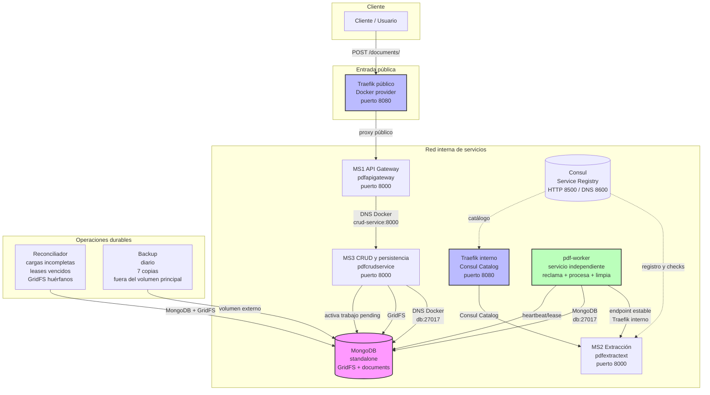
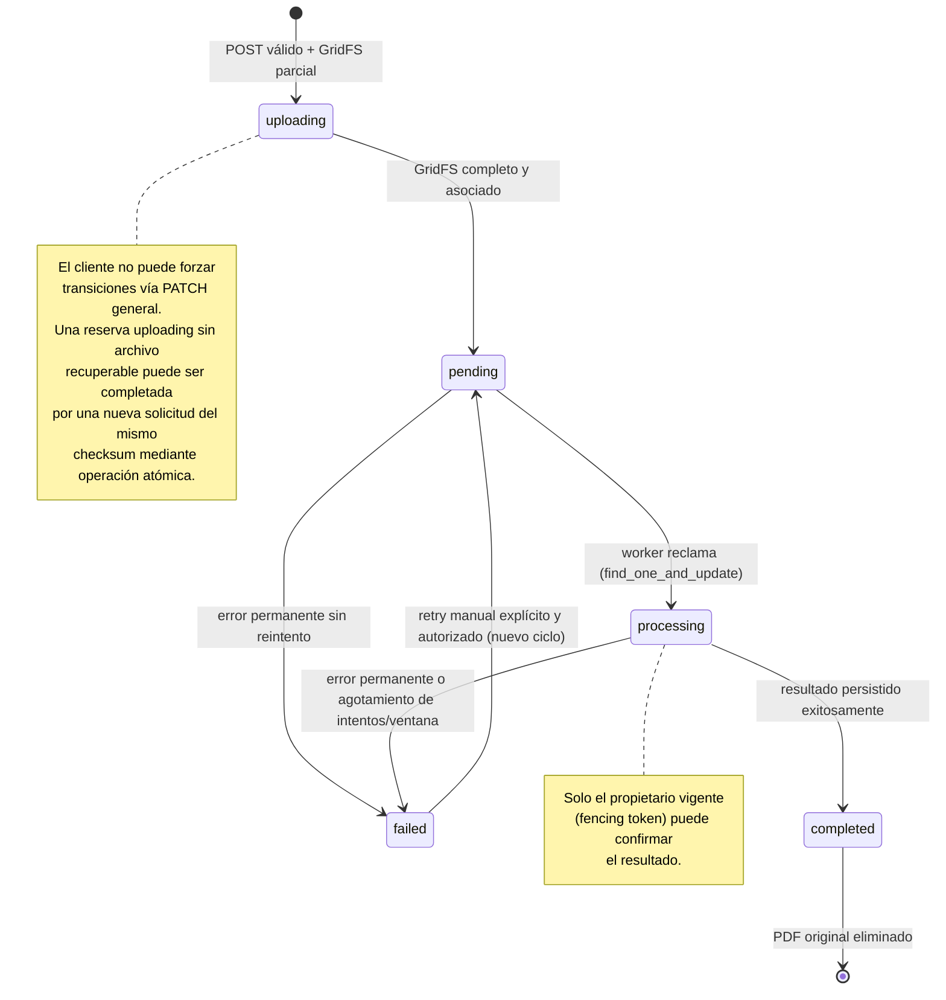

# ARQUITECTURA TÉCNICA — Sistema de Procesamiento de PDFs

**Repositorio central:** `Microservicios/`  
**Versión:** 1.6  
**Fecha:** 2026-11-23  
**Estado:** Documento de arquitectura para revisión y aprobación. No es especificación de implementación cerrada.

---

## 1. Portada y versión

| Campo | Valor |
|-------|-------|
| Título | Arquitectura Técnica — Procesamiento Asíncrono de Documentos PDF |
| Versión | 1.6 |
| Fecha | 2026-11-23 |
| Alcance | Consolidador de las decisiones de arquitectura aprobadas (Acuerdos 1–10 y criterios cerrados de actualización v1.1 y v1.2) |
| Tipo | Documento técnico de análisis y diseño |
| Repositorios | `pdfapigateway`, `pdfextractext`, `pdfcrudservice`, `pdfinfraestructure` |

**Regla de trabajo:** este documento no modifica código, configuración, Dockerfiles ni Docker Compose. Separa explícitamente el estado actual de los repositorios de la arquitectura objetivo. Todo lo marcado como *propuesto* o *pendiente de definición* requiere aprobación antes de ser implementado.

---

## 2. Historial de cambios

| Versión | Fecha | Cambios principales |
|---------|-------|---------------------|
| 1.0 | 2026-11-23 | Consolidación inicial de los diez acuerdos de arquitectura aprobados. |
| 1.1 | 2026-11-23 | Incorporación de criterios cerrados v1.1: duplicados `200 OK`, fencing independiente de `processing_cycle_id`, timeout worker→MS2 40s, liberación de lease al reintentar, readiness independiente de liveness, Consul con arranque degradado, backups diarios y 7 copias, orden de implementación en 7 etapas. |
| 1.2 | 2026-11-23 | Correcciones v1.2: unificación de deduplicación y recuperación de `uploading`; filtro corregido de `next_retry_at` para documentos sin el campo; máquina de estados sin `uploading` → `failed` por carga interrumpida ni `pending` → `failed` por retry manual denegado; recuperación de leases vencidos mediante claim atómico directo sin transición intermedia a `pending`; unificación de readiness/saturación/Consul; códigos HTTP claros sin `400` para duplicados; reglas explícitas de `attempt_count` y `fencing_token`. |
| 1.3 | 2026-11-23 | Correcciones v1.3: eliminación de `processing` → `pending` de la máquina de estados (recuperación de lease vencido mantiene `processing`); `attempt_count` se incrementa antes de la llamada real a MS2 (no después); `HALF-OPEN` con llamada real cuenta como intento; `OPEN` bloquea sin consumir intento; `/ready` de MS2 definido como inicialización completada (no como ausencia de saturación); eliminación de transición genérica `cualquiera` → `failed`; documentación ampliada de recuperación concurrente de reservas `uploading`; tabla de códigos HTTP 14.1 sincronizada con 14.4. |
| 1.4 | 2026-11-23 | Correcciones v1.4: Flujo 6 reordenado (Circuit Breaker se evalúa antes de incrementar `attempt_count`; `OPEN` no consume intentos); `upload_owner_id` separado de `worker_id` para la propiedad de carga de PDF; protección de cargas activas con renovación de lease y fencing antes de asociar `file_id`; respuesta `200 OK` al perder exclusividad de reserva `uploading` (recurso existente, puede seguir en `uploading`); sección 11.4b para recuperación de `processing` con lease vencido, distinta del polling de `pending`; sección 13 y 9.5 sincronizadas con reconciliadores de carga y leases de carga. |
| 1.5 | 2026-11-23 | Correcciones v1.5: adquisición de exclusividad de carga `uploading` condicionada a lease vencido o ausencia de propietario vigente; renovación de `upload_lease_until` protegida por `upload_owner_id` y `upload_fencing_token` vigentes; reconciliador distingue explícitamente carga activa (lease vigente) de carga abandonada (lease vencido) y no interviene sobre cargas activas; limpieza GridFS no elimina archivos de carga con lease válido; matriz A09 ampliada con 8 escenarios de exclusividad y recuperación concurrente; sección 28 ampliada con verificaciones 24-37. |
| 1.6 | 2026-11-23 | Correcciones v1.6: operación atómica final de asociación de `file_id` y transición a `pending` condicionada simultáneamente a `status=uploading`, `upload_owner_id` vigente, `upload_fencing_token` vigente, `upload_lease_until >= ahora` y ausencia de `file_id`; pérdida de propiedad interrumpe escritura GridFS antes de limpieza; doble protección con fencing token (propietario anterior) y lease vigente (vencimiento sin nuevo propietario); limpieza GridFS requiere cesación confirmada de escritura y no elimina archivos de carga activa; A09 incluye escenario explícito de lease vencido sin nuevo propietario y verificación de detención de escritura GridFS. |

---

## 3. Objetivo y alcance

El documento consolida las decisiones de arquitectura aprobadas en una arquitectura técnica única, contrasta cada decisión con el código real inspeccionado en los repositorios, define los flujos completos, el modelo de datos objetivo, los contratos, la infraestructura y detecta las definiciones técnicas pendientes.

Se incluyen:

- Estado actual de los cuatro repositorios.
- Arquitectura lógica objetivo.
- Responsabilidades por componente.
- Flujos de procesamiento end-to-end.
- Máquina de estados.
- Modelo de datos de MongoDB y GridFS.
- Estrategia de workers, leases y concurrencia.
- Reintentos y Circuit Breaker.
- Orquestación y recuperación.
- API y contratos entre servicios.
- Logging y trazabilidad.
- Consul y descubrimiento de servicios.
- Traefik y balanceo.
- Topología Docker Compose propuesta.
- Backups y restauración.
- Seguridad.
- Estrategia de pruebas.
- Matriz de aceptación A01-A28.
- Riesgos y decisiones realmente pendientes.
- Orden recomendado de implementación.
- Glosario.

No se incluyen decisiones que contradigan los acuerdos aprobados. Los acuerdos son definitivos a nivel conceptual y no se reabren en este documento.

---

## 4. Contexto del sistema

El sistema recibe archivos PDF de clientes, los almacena de forma durable, extrae el texto de forma asíncrona y permite consultar el estado y el resultado. Está compuesto por:

- **Cliente:** envía `POST /documents/` y consulta `GET /documents/{id}`.
- **MS1 (`pdfapigateway`):** API Gateway. Punto de entrada único. Deriva solicitudes a MS3.
- **MS3 (`pdfcrudservice`):** servicio de persistencia y gestión de documentos. Valida, almacena en MongoDB y activa trabajos durables.
- **MongoDB:** fuente de verdad de documentos y trabajos. Almacena PDF originales en GridFS.
- **`pdf-worker`:** servicio independiente de procesamiento. Reclama trabajos, llama a MS2, persiste resultados y limpia artefactos.
- **MS2 (`pdfextractext`):** servicio stateless de extracción de texto de PDF.
- **Traefik público:** entrada externa hacia MS1.
- **Traefik interno:** balanceo hacia MS2.
- **Consul:** Service Registry obligatorio para el descubrimiento de réplicas de MS2.
- **Reconciliadores y backups:** recuperación de cargas incompletas, leases vencidos, limpieza de GridFS y copias de seguridad.

El procesamiento es asíncrono: el cliente recibe `202 Accepted` solo cuando el archivo y el trabajo están almacenados de forma durable. La extracción puede completarse después de que el cliente haya cerrado la conexión HTTP. Si no se pudo persistir el PDF y el trabajo, no se debe responder `202`.

---

## 5. Decisiones de arquitectura aprobadas

Las siguientes decisiones son definitivas y no deben reaperturarse en este documento.

### 5.1 API asíncrona

- El cliente envía `POST /documents/`.
- MS1 deriva la solicitud a MS3.
- MS3 valida el PDF y lo almacena durablemente en GridFS.
- También debe persistir la metadata y el trabajo.
- Solo después de completar correctamente la persistencia se responde `202 Accepted`.
- La respuesta incluye identificador, estado, fecha de creación y URL de consulta.
- `Location` apunta al recurso de consulta.
- El cliente consulta mediante `GET /documents/{id}`.

Si no se pudo persistir el PDF y el trabajo, no se debe responder `202`.

### 5.2 Máquina de estados

Estados:

- `uploading`
- `pending`
- `processing`
- `completed`
- `failed`

Las transiciones deben estar controladas por MS3 y los workers.

El cliente no puede modificar arbitrariamente el estado mediante un PATCH general.

El retry manual debe estar explícitamente autorizado.

### 5.3 Deduplicación

- Calcular SHA-256 sobre los bytes exactos del PDF.
- Utilizar un índice único `checksum_unique`.
- Un PDF duplicado debe devolver el documento existente.
- No debe crear otro documento ni otro trabajo.
- La deduplicación aplica a todos los estados.
- Si existe un documento `failed`, recibir nuevamente el mismo PDF no debe provocar un reintento automático.
- Las colisiones de inserción deben resolverse recuperando el documento ganador.

**Respuesta HTTP para duplicados: `200 OK`.**

La respuesta debe incluir el ID, estado y URL de consulta del documento existente.

No implementar `Idempotency-Key` como requisito de esta arquitectura.

### 5.4 Recuperación de cargas incompletas (`uploading`)

Se establecen los siguientes escenarios y reglas de comportamiento:

**A. Documento existente en estado `completed`, `pending`, `processing` o `failed`:**
- Devolver `200 OK` con el documento existente, sin crear un nuevo trabajo.
- No se crea un segundo documento ni un segundo trabajo.

**B. Documento `uploading` cuyo archivo en GridFS está completo y es recuperable:**
- El reconciliador verifica su integridad, asocia el `file_id` y pasa el documento a `pending`.
- Una nueva solicitud con el mismo checksum recupera el documento existente y evita crear un segundo documento.

**C. Documento `uploading` con un archivo parcial o incompleto:**
- Se elimina el archivo parcial de GridFS.
- Se permite recuperar la carga mediante una nueva solicitud.

**D. Reserva `uploading` sin archivo recuperable:**
- Se conserva la reserva del checksum.
- Una nueva solicitud con el mismo checksum debe poder completar esa reserva existente mediante una operación atómica, en lugar de responder simplemente `200 OK`.

**Propiedad de la carga vs. propiedad del trabajo de extracción:**

La entidad que completa una reserva `uploading` (sube el archivo a GridFS) no es necesariamente un `pdf-worker` de extracción. Para evitar mezclar responsabilidades, se introduce un identificador independiente:

- `upload_owner_id`: identifica al proceso que está completando o ha completado la carga del PDF a GridFS para una reserva `uploading`. Es independiente de `worker_id` (que identifica al propietario de un trabajo de extracción en estado `processing`).
- `upload_lease_until`: fecha de expiración del lease de carga, independiente de `lease_until` (que pertenece al trabajo de extracción).
- `upload_fencing_token`: token de fencing para la operación de carga, independiente de `fencing_token` (que pertenece al trabajo de extracción).

**Mecanismo de exclusión para completar una reserva `uploading`:**

1. Una solicitud con checksum duplicado identifica la reserva `uploading` existente mediante consulta por `checksum`.
2. Para obtener el derecho exclusivo de completar la reserva, la solicitud ejecuta una actualización condicional atómica (`find_one_and_update` o `update_one` con filtro) que establece `upload_owner_id`, renueva `upload_lease_until` y asigna un nuevo `upload_fencing_token`, solo si se cumplen **todas** las siguientes condiciones:
   - El documento continúa en estado `uploading`.
   - No tiene `file_id` asociado.
   - No existe un propietario vigente, o el lease de carga anterior ya venció.
   
   Filtro de referencia (adaptar a la representación de campos elegida):
   ```javascript
   {
     status: "uploading",
     file_id: null,
     $or: [
       { upload_owner_id: { $exists: false } },
       { upload_owner_id: null },
       { upload_lease_until: { $lt: ahora } }
     ]
   }
   ```
   Una solicitud que encuentra un lease todavía vigente **no puede** reemplazar al propietario actual.
3. Si la actualización afecta 0 documentos, otra solicitud ya ganó la exclusividad (o el lease del propietario actual sigue vigente); la solicitud perdedora recupera el documento existente y devuelve su ID, estado y URL de consulta (`200 OK`), sin crear un segundo documento ni archivo. La respuesta `200 OK` no significa que la carga o el procesamiento hayan finalizado: el estado puede seguir siendo `uploading`, y el cliente puede consultar el progreso mediante `GET /documents/{id}`.
4. La solicitud ganadora carga el PDF a GridFS y confirma que la carga terminó.
5. Durante una carga prolongada, la solicitud ganadora renueva `upload_lease_until` periódicamente para evitar que el lease venza mientras la carga sigue activa. **Cada renovación debe realizarse mediante una actualización atómica condicionada por:**
   - El documento continúa en estado `uploading`.
   - `upload_owner_id` coincide con el propietario actual.
   - `upload_fencing_token` coincide con el token de la solicitud actual.
   - `upload_lease_until` todavía no venció.
   
   Solo si se cumplen todas las condiciones se puede extender el lease. Si la actualización afecta cero documentos, la solicitud perdió la propiedad y debe dejar de actuar como propietaria. En ese caso:
   - No puede seguir renovando el lease.
   - No puede asociar `file_id`.
   - No puede cambiar el documento a `pending`.
   - Debe tratar los archivos GridFS que haya creado como posibles huérfanos, sujetos a limpieza segura por el reconciliador.
   
   El intervalo de renovación y la duración del lease de carga son **parámetros pendientes de definición en la implementación** (no hay decisión aprobada que fije un valor concreto; no se debe inventar uno).
6. **Comprobación anticipada (opcional, no sustituye la actualización atómica final):** antes de iniciar la asociación de `file_id`, la solicitud ganadora puede verificar localmente que sigue siendo el propietario vigente (`upload_fencing_token` coincide y `upload_lease_until` no ha vencido). Esta verificación es una optimización para evitar trabajo innecesario, pero **no sustituye** las condiciones de la actualización atómica final.
7. **Operación atómica final de asociación y transición:** la solicitud ganadora asocia `file_id` y transiciona el documento de `uploading` a `pending` mediante una **única actualización atómica condicionada** (`find_one_and_update` o `update_one` con filtro) que exige **simultáneamente** todas las siguientes condiciones:
   - `status = "uploading"`.
   - `upload_owner_id` igual al identificador del propietario actual.
   - `upload_fencing_token` igual al token de la solicitud actual.
   - `upload_lease_until >= ahora` (el lease sigue vigente en el momento de la escritura).
   - `file_id` inexistente o nulo.
   
   Filtro de referencia (adaptar a la representación de campos elegida):
   ```javascript
   {
     status: "uploading",
     upload_owner_id: mi_upload_owner_id,
     upload_fencing_token: mi_upload_fencing_token,
     upload_lease_until: { $gte: ahora },
     $or: [
       { file_id: { $exists: false } },
       { file_id: null }
     ]
   }
   ```
   
   **Doble protección explicada:**
   - El **fencing token** impide escrituras de un propietario anterior **después de que otro haya adquirido la reserva** (el nuevo propietario tiene un token distinto).
   - La condición **`upload_lease_until >= ahora`** impide que el propietario actual escriba **después del vencimiento del lease**, incluso si **nadie más ha adquirido la reserva todavía** (el lease venció y la ventana está abierta para una nueva adquisición).
   
   Si la actualización afecta **cero documentos**:
   - La solicitud perdió la propiedad (otro ganó la exclusividad) **o** venció su lease.
   - **No puede asociar `file_id`.**
   - **No puede pasar el documento a `pending`.**
   - **Debe detener inmediatamente cualquier escritura pendiente a GridFS y cerrar o abortar la carga en curso cuando sea posible.**
   - Sus archivos GridFS (completos o parciales) quedan como **posibles huérfanos, sujetos a limpieza segura posterior** por el reconciliador.
8. Si el `upload_lease_until` vence y otra solicitud obtiene la reserva mediante una nueva actualización condicional (paso 2), el propietario anterior pierde la propiedad y no puede asociar un archivo después de perderla. Cualquier intento del propietario anterior de escribir `file_id` con un `upload_fencing_token` antiguo afectará 0 documentos (protección por fencing token).
9. **Comportamiento del reconciliador ante cargas incompletas:** el reconciliador debe distinguir explícitamente:
   - **Carga activa:** el documento está en `uploading`, tiene un propietario vigente (`upload_owner_id` presente) y `upload_lease_until` todavía no venció. **Acción:** no intervenir sobre esa carga. No limpiar archivos que puedan pertenecer al propietario activo ni intentar adquirir su reserva.
   - **Carga abandonada:** el documento continúa en `uploading` y el lease de carga venció (`upload_lease_until < ahora`). **Acción:** puede iniciar la recuperación mediante el mecanismo de exclusividad atómica descrito en el paso 2. Debe volver a comprobar el vencimiento en la operación atómica, porque el lease podría renovarse entre la consulta inicial y la adquisición.
   
   Si la solicitud ganadora falla o se interrumpe antes de asociar `file_id`, el `upload_lease_until` vence y el reconciliador (o una nueva solicitud concurrente) puede repetir el mecanismo de exclusión desde el paso 2.
10. **Limpieza de archivos GridFS:** el reconciliador puede limpiar archivos parciales o huérfanos únicamente cuando se cumplan **todas** las siguientes condiciones:
    - Ha verificado que **no pertenecen a una carga activa** (el documento no está en `uploading` con `upload_owner_id` vigente y `upload_lease_until` no vencido).
    - Ha confirmado que **la operación de carga ha cesado**: el lease venció y no hay renovaciones recientes, **y** el propietario anterior ha dejado de escribir (la actualización atómica del paso 7 falló o el lease venció sin que se asociara `file_id`).
    - No hay una escritura GridFS en curso que todavía pueda estar produciendo datos.
    
    La limpieza debe ser **idempotente**. No debe eliminar archivos de una carga cuyo propietario todavía conserva un lease válido. **No debe permitir que un propietario antiguo siga escribiendo mientras el reconciliador limpia sus archivos**: la cesación de la escritura GridFS por el propietario anterior (al detectar que su actualización atómica falló o que su lease venció) es condición previa para considerar el archivo como seguro para limpieza. No se introduce un mecanismo de coordinación nuevo, ni colecciones, brokers o transacciones multidocumento; la coordinación se logra mediante las actualizaciones condicionales atómicas sobre el documento y la verificación del estado del lease y el fencing token.
11. El índice único de checksum impide que se creen dos documentos para el mismo checksum, por lo que no es posible generar documentos duplicados ni asociaciones inconsistentes.
12. No se introduce una colección adicional, ni un broker, ni una transacción multidocumento; toda la exclusión se resuelve con actualizaciones condicionales atómicas sobre el mismo documento de `documents`.

El índice único de checksum y la deduplicación SHA-256 sobre los bytes exactos del PDF se mantienen como mecanismos de protección.

### 5.5 Persistencia

- MongoDB es la fuente de verdad.
- GridFS almacena los PDF originales.
- Una colección `documents` almacena metadata y trabajos.
- No se introduce una colección de jobs separada.
- MongoDB funciona como standalone, sin replica set ni transacciones multidocumento.
- La consistencia se garantiza mediante escrituras ordenadas, operaciones atómicas individuales, idempotencia y reconciliadores.
- Operaciones críticas con `write concern: w:1, j:true`.
- El PDF original se conserva hasta persistir el resultado.

### 5.6 Workers

Se utiliza un servicio independiente `pdf-worker`.

- Reclama trabajos mediante `find_one_and_update`.
- Utiliza leases y heartbeat.
- Lease inicial: 60 segundos.
- Heartbeat: cada 15 segundos.
- Concurrencia inicial: 2 documentos por worker.
- Una réplica inicial.
- Polling inicial: 1 segundo, con backoff hasta 5 segundos.
- Heartbeat paralelo durante llamadas HTTP largas.

#### Separación de identificadores

`processing_cycle_id`:
- UUID que identifica un ciclo completo de procesamiento.
- Se conserva durante reintentos automáticos.
- Cambia cuando se ejecuta un retry manual.

`fencing_token`:
- Identifica cada adquisición o reclamación del trabajo.
- Cambia cada vez que un worker reclama o vuelve a reclamar un trabajo.
- Toda escritura de resultado y finalización debe verificar el token vigente.
- Un worker antiguo no puede confirmar resultados después de perder la propiedad del trabajo.

Nunca deben utilizarse como equivalentes.

El documento v1.1 define `fencing_token` como un identificador por reclamación (no necesariamente un UUID genérico, sino un valor que cambia en cada reclamación). Una alternativa técnica compatible sería un contador monotónico por documento que se incrementa en cada nueva reclamación; sin embargo, cambiar silenciosamente el criterio aprobado no corresponde. Si se adopta el contador monotónico durante la implementación, debe tratarse como una precisión técnica compatible con el objetivo de fencing, no como una nueva decisión de arquitectura.

#### Recuperación de leases vencidos

Cuando un worker detecta un documento `processing` cuyo `lease_until` venció:

1. Ejecuta una operación atómica de reclamación (`find_one_and_update` condicionado).
2. La operación verifica que el lease siga vencido (`lease_until < ahora`).
3. Actualiza el propietario del trabajo (`worker_id`).
4. Renueva `lease_until` (ahora + 60s).
5. Actualiza el `fencing_token` (nuevo valor por reclamación).
6. El nuevo worker continúa el procesamiento.

No debe existir una transición intermedia obligatoria `processing` → `pending` para recuperar un lease vencido. El reconciliador no debe competir con el worker realizando otra transición para el mismo caso.

### 5.7 Reintentos

Política mixta: backoff exponencial con jitter.

- 5 intentos totales, incluyendo el inicial.
- Esperas base: 2, 4, 8 y 16 segundos, con jitter.
- Espera máxima: 30 segundos.
- Ventana máxima por ciclo: 10 minutos.
- `Retry-After` se respeta cuando corresponda, sin superar la ventana máxima.
- Al agotar intentos o ventana, pasar a `failed`.

Errores transitorios:
- HTTP 429.
- HTTP 500, 502, 503 y 504.
- Timeout.
- Errores de conexión y DNS.

Errores permanentes:
- PDF inválido o corrupto.
- Tamaño excedido.

#### Contador `attempt_count`

Regla única de contabilización:

- `attempt_count` se incrementa cuando el worker inicia una llamada real al microservicio MS2.
- Se incrementa tanto si la llamada termina correctamente como si termina con error.
- No se incrementa cuando el Circuit Breaker está en estado `OPEN` y bloquea la llamada antes de enviarla.
- Si el Circuit Breaker está en `HALF-OPEN` y permite una llamada real, esa llamada sí consume un intento.
- No incrementar el contador por simples operaciones de polling, claims o renovaciones de heartbeat.

El intento inicial cuenta como el primero de los cinco intentos totales. Los reintentos automáticos consumen los intentos restantes.

#### Liberación del worker

Cuando se programa un reintento:

- Persistir `next_retry_at`.
- Volver el documento a `pending`.
- Liberar `worker_id`.
- Liberar `lease_until`.
- El worker no debe dormir ni mantener el lease durante el backoff.
- El polling debe contemplar trabajos nuevos sin `next_retry_at` (ver sección 13.3 para la consulta corregida).

### 5.8 Timeout worker → MS2

- Timeout inicial de 40 segundos por llamada HTTP.
- Configurable mediante variable de entorno.
- Si vence, se considera error transitorio.
- Se aplica la política de reintentos.
- El heartbeat continúa funcionando en paralelo.
- El timeout por llamada es independiente de la ventana de 10 minutos del ciclo.

### 5.9 Saga

- No implementar una Saga formal ni un motor genérico.
- Utilizar orquestación ligera persistida por el worker.
- MongoDB es la fuente de verdad.
- Los reconciliadores recuperan operaciones incompletas.
- Las compensaciones se limitan a limpieza segura de artefactos huérfanos.
- No introducir un broker.

### 5.10 Circuit Breaker

Inicialmente solo entre worker y MS2.

- Estado local por proceso worker.
- 5 fallos en ventana de 60 segundos para abrir.
- OPEN mínimo 30 segundos.
- HALF-OPEN permite una prueba simultánea por breaker local.
- Los errores de transporte, timeout, DNS y respuestas 500/502/503/504 cuentan.
- 429 repetidos también participan.
- Los errores 400/413/422 no cuentan.
- OPEN no envía llamadas, no consume intentos y no mantiene leases esperando.
- Retry y Circuit Breaker son mecanismos independientes.
- Una llamada real HALF-OPEN cuenta como intento.

No introducir Redis ni estado compartido para el Circuit Breaker inicial.

### 5.11 Consul y Traefik

Consul es obligatorio por requerimiento académico.

- Consul funciona como Service Registry/Catalog.
- Cada réplica MS2 se registra individualmente.
- Traefik interno utiliza Consul Catalog para descubrir MS2.
- Traefik público mantiene Docker provider para MS1.
- MS1 → MS3 utiliza DNS Docker.
- MS3 → MongoDB utiliza DNS Docker.
- No duplicar backends MS2 entre providers.

#### Versión

Fijar una versión estable y concreta de Consul en Docker Compose.

No utilizar `latest`.

El número exacto se verificará durante la preparación de la implementación, comprobando compatibilidad.

#### Registro de réplicas

- Registro mediante Consul Agent HTTP API al iniciar.
- Cada instancia tiene un ID único.
- Registrar dirección, puerto y health check.
- Desregistro explícito al apagarse ordenadamente.
- Las caídas abruptas se detectan mediante health checks.
- Las instancias no saludables deben dejar de recibir tráfico.

#### Arranque degradado

Si Consul no está disponible:

- MongoDB y MS3 pueden iniciar normalmente.
- MS3 puede aceptar y almacenar documentos si MongoDB está disponible.
- MS2 puede iniciar aunque no consiga registrarse.
- Las instancias reintentan el registro.
- El worker puede iniciar y reintentar la comunicación con Consul.
- Traefik interno puede carecer de rutas actualizadas.
- Los trabajos permanecen persistidos en MongoDB hasta que exista una ruta válida hacia MS2.

Consul no debe ser la fuente de verdad de los trabajos.

#### Seguridad

- No exponer la API administrativa de Consul públicamente.
- ACL habilitadas.
- Tokens con privilegios mínimos.
- TLS para comunicaciones con Consul.
- No guardar secretos en Consul KV inicialmente.

### 5.12 Liveness y readiness de MS2

- `/health`: liveness. Indica si el proceso sigue funcionando.
- `/ready`: readiness. Indica si la instancia terminó de inicializarse y está operativamente preparada para recibir solicitudes.

Consul y Traefik deben utilizar readiness para seleccionar instancias aptas.

La saturación momentánea no debe marcar automáticamente una instancia como no saludable. Debe manejarse mediante admission control.

Cuando la capacidad disponible se agota, la instancia debe responder con el código de rechazo definido, por ejemplo `429` o `503`, según el contrato acordado.

No modificar automáticamente el estado de salud de Consul por una saturación transitoria.

### 5.13 Fallos de MongoDB

- Si MS3 no puede persistir, responde `503 Service Unavailable`.
- Nunca devuelve `202` sin persistencia durable.
- Los workers no procesan ni confirman resultados cuando MongoDB no está disponible.
- Los servicios intentan reconectarse en segundo plano.
- No realizar reintentos indiscriminados de operaciones CRUD.
- Los trabajos existentes permanecen almacenados y continúan cuando MongoDB se recupera.

### 5.14 Capacidad y escalabilidad

- Dos documentos simultáneos por worker inicialmente.
- Cada réplica MS2 tiene admission control propio.
- Workers y MS2 escalan independientemente.
- No definir un límite global arbitrario todavía.
- Medir la capacidad con k6 y Vegeta.
- Definir límites globales posteriormente a partir de mediciones reales.

### 5.15 Limpieza de GridFS

Después de persistir el resultado y marcar el documento como `completed`:

- Eliminar el PDF original de GridFS.
- Si falla el borrado, el documento sigue en `completed`.
- Registrar la limpieza pendiente.
- Un reconciliador reintenta la eliminación.
- La operación debe ser idempotente.
- Nunca volver a extraer un PDF únicamente porque falló su eliminación.

### 5.16 Retry manual

- Operación explícita y autorizada.
- Reinicia `attempt_count` para el nuevo ciclo.
- Conserva el historial de intentos anteriores.
- Conserva el PDF original.
- Genera un nuevo `processing_cycle_id`.
- Debe evitar carreras con workers que todavía tengan reclamaciones anteriores.
- Una solicitud de retry manual no autorizada debe responder `401 Unauthorized` o `403 Forbidden`, según corresponda, sin modificar el documento ni cambiar su estado.

### 5.17 Backups

- Backups diarios.
- Retención de siete copias.
- Almacenamiento fuera del volumen principal de MongoDB.
- Backup de metadata y archivos GridFS.
- Restauración documentada.
- Pruebas periódicas de restauración en entorno aislado.
- Verificación de checksums, estados y referencias GridFS.

Consideración técnica importante: MongoDB standalone no dispone de las mismas garantías de backup en caliente que un replica set con oplog. Documentar un procedimiento consistente de backup y restauración, coordinando la copia de metadata y GridFS. No afirmar garantías que la topología no proporciona.

---

## 6. Arquitectura lógica objetivo

### 6.1 Componentes definitivos



### 6.2 Responsabilidades y límites

| Componente | Responsabilidades | Límites / no hace |
|------------|-------------------|-------------------|
| Cliente | Envía PDF, consulta estado, recibe 202 | No procesa, no almacena durablemente |
| MS1 | Proxy único hacia MS3; propaga status, headers, cuerpo; traduce errores de transporte a 502/504 | No lógica de negocio, no MongoDB, no MS2 directo, no GridFS |
| MS3 | Valida PDF, almacena original en GridFS, registra documento y trabajo, activa `pending`, responde `202`, protege campos de estado | No extrae texto, no es worker, no coordina leases directamente |
| MongoDB + GridFS | Fuente de verdad; almacena documentos, trabajos, checksums, intentos, leases, resultados; PDF originales en GridFS | No ejecuta lógica de aplicación, no es broker de mensajes |
| `pdf-worker` | Reclama `pending`, actualiza a `processing`, llama a MS2, persiste resultado, finaliza `completed`/`failed`, reintenta, limpia PDF, heartbeat, fencing | No es backend HTTP, no coordina Saga formal, no usa Consul para jobs |
| MS2 | Extrae texto y páginas de PDF de forma stateless | No persiste, no gestiona estado de documento, no conoce leases |
| Traefik público | Entrada externa a MS1; Docker provider | No descubre MS2 para workers, no usa Consul Catalog |
| Traefik interno | Balanceo hacia MS2 mediante Consul Catalog | No expone MS2 públicamente |
| Consul | Registro individual de réplicas MS2, health checks, catálogo para Traefik interno | No coordina jobs, no KV en primera etapa, no es backend para worker |
| Reconciliadores | Recuperar `uploading`/`pending`/`processing` abandonados, limpiar GridFS huérfanos, recuperar leases vencidos | No son workers de procesamiento regulares |
| Backups | Copias diarias, 7 copias, fuera del volumen principal, prueba de restore | No forman parte del flujo de procesamiento en tiempo real |

---

## 7. Flujos de procesamiento

Cada flujo indica el componente responsable y qué se persiste en MongoDB. Los flujos que dependen de componentes no implementados están marcados como *futuro*.

### Flujo 1 — Recepción de un PDF nuevo

1. Cliente envía `POST /documents/` con `multipart/form-data` campo `file` a MS1 vía Traefik público.
2. MS1 reenvía el multipart a MS3 (`POST /documents/`), propagando encabezados salvo hop-by-hop, `Host`, `Content-Length`.
3. MS3 genera `correlation_id` (si el cliente no lo provee) y lo incluye en logs.
4. MS3 valida MIME `application/pdf`, archivo no vacío y tamaño ≤ 5 MB.
5. MS3 calcula SHA-256 de los bytes exactos.
6. MS3 consulta `documents` por `checksum`.
   - Si existe un documento en estado `completed`, `pending`, `processing` o `failed`: aplicar Flujo 2 (duplicado, `200 OK`).
   - Si existe un documento `uploading` con archivo completo y recuperable: aplicar reconciliación de carga (asociar `file_id`, pasar a `pending`).
   - Si existe un documento `uploading` con archivo parcial o incompleto: eliminar archivo parcial y permitir recuperar la carga.
   - Si existe una reserva `uploading` sin archivo recuperable: la solicitud puede completar esa reserva existente mediante el mecanismo de exclusividad atómica de la sección 5.4 (paso 2), que verifica que no hay propietario vigente o que el lease de carga venció.
   - Si no existe documento: continuar al paso 7.
7. MS3 crea documento en `documents` con estado `uploading`, checksum, tamaño, nombre, referencia de GridFS pendiente.
8. MS3 carga el PDF a GridFS y confirma la carga completa.
9. MS3 asocia `file_id` de GridFS al documento y transiciona atómicamente a `pending` mediante una única actualización condicionada que verifica simultáneamente: `status=uploading`, `upload_owner_id` vigente, `upload_fencing_token` vigente, `upload_lease_until >= ahora` y ausencia de `file_id` (sección 5.4, paso 7).
10. MS3 responde `202 Accepted` con `document_id`, `status`, `created_at`, `status_url` y header `Location` apuntando a `GET /documents/{id}`.
11. Se persiste: documento en `documents` (estado `pending`), objeto GridFS con el PDF original, `correlation_id` en logs.

**Persistencia en MongoDB:** documento creado en `uploading`, luego `pending`; `file_id` de GridFS; checksum; intentos iniciales en 0.

### Flujo 2 — Recepción de un PDF duplicado

1. Pasos 1-6 del Flujo 1 hasta detectar checksum existente.
2. Si el documento existente está en estado `completed`, `pending`, `processing` o `failed`:
   - MS3 devuelve `200 OK` con el ID existente, estado actual, fecha de creación y URL de consulta.
   - No se crea un segundo documento ni un segundo trabajo.
   - Si el estado es `failed`, no se dispara retry automático.

**Persistencia:** ninguna escritura nueva; solo lectura de `documents`.

### Flujo 3 — Carga incompleta o interrumpida

1. MS3 recibe el PDF y crea el documento en `uploading`.
2. La carga a GridFS se interrumpe antes de confirmarse completa.
3. MS3 se reinicia o cae antes de transicionar a `pending`.
4. Al reiniciar, el reconciliador escanea `documents` en estado `uploading` sin `file_id` asociado o con carga incompleta.
5. **El reconciliador distingue primero si la carga está activa o abandonada (sección 5.4, paso 9):**
   - **Carga activa:** existe `upload_owner_id` y `upload_lease_until` no ha vencido. El reconciliador **no interviene**; no limpia archivos ni intenta adquirir la reserva.
   - **Carga abandonada:** el lease de carga venció (`upload_lease_until < ahora`). El reconciliador procede según los pasos siguientes.
6. Si el archivo en GridFS está completo e íntegro (carga abandonada): se asocia `file_id` y el documento pasa a `pending` mediante la operación atómica final de la sección 5.4 (paso 7), que exige `status=uploading`, `upload_owner_id`/`upload_fencing_token` del recuperador, `upload_lease_until >= ahora` (verificado en la adquisición) y ausencia de `file_id`.
7. Si el archivo está incompleto (carga abandonada): el reconciliador limpia el objeto GridFS parcial **solo tras confirmar que la escritura GridFS ha cesado** (el lease venció y no hay renovaciones, o el propietario anterior abortó al fallar su actualización atómica). La limpieza es idempotente y no elimina archivos mientras pueda haber una escritura en curso.
8. Si existe una reserva `uploading` sin archivo recuperable (carga abandonada): se conserva la reserva del checksum y una nueva solicitud del mismo PDF puede completar esa reserva mediante el mecanismo de exclusividad atómica de la sección 5.4 (paso 2), que vuelve a verificar atómicamente el vencimiento del lease.
9. El cliente puede reenviar el mismo PDF; el índice único evita duplicados y recupera el documento existente.

**Persistencia:** documento en `uploading`; posible objeto GridFS parcial a limpiar; registro de intento de reconciliación en logs.

### Flujo 4 — Activación de un trabajo

1. Documento en `pending` en `documents`.
2. MS3 confirma que el archivo GridFS está asociado y completo.
3. El documento queda visible para el worker como candidato a reclamar.
4. El worker ejecuta `find_one_and_update` con filtro `status = "pending"` y actualiza a `processing`, estableciendo `worker_id`, `lease_until` (ahora + 60s), `heartbeat_at`, `processing_cycle_id` (UUID, conserva durante reintentos automáticos) y `fencing_token`.
5. La operación es atómica por documento en MongoDB; solo un worker gana el claim.

**Persistencia:** transición `pending` → `processing`; `worker_id`, `lease_until`, `heartbeat_at`, `processing_cycle_id`, `fencing_token`.

### Flujo 5 — Reclamo de un trabajo por un worker

1. Worker hace polling cada 1 s, con espera progresiva hasta 5 s si no hay candidatos.
2. Worker consulta `documents` con el filtro corregido (ver sección 13.3):
   ```javascript
   {
     status: "pending",
     $or: [
       { next_retry_at: { $exists: false } },
       { next_retry_at: null },
       { next_retry_at: { $lte: ahora } }
     ]
   }
   ```
   ordenado por `created_at`.
3. Worker aplica `find_one_and_update` para reclamar uno o hasta dos documentos simultáneos.
4. Si gana el claim, pasa a procesar; si pierde, vuelve a polling.
5. Mientras procesa, el worker envía heartbeat cada 15 s actualizando `heartbeat_at` y puede extender `lease_until` si sigue propietario.

**Persistencia:** claim atómico; `lease_until` y `heartbeat_at` actualizados.

### Flujo 6 — Procesamiento exitoso

1. El worker obtiene el trabajo reclamado y verifica que sigue siendo propietario vigente (`fencing_token` coincide).
2. Circuit Breaker local del worker evalúa si el circuito permite enviar la llamada a MS2.
3. Si el circuito está `OPEN`, el worker no envía la llamada y no incrementa `attempt_count`: reprograma el trabajo, vuelve a `pending`, libera `worker_id` y `lease_until`.
4. Si el circuito está `CLOSED` o `HALF-OPEN` y permite una llamada real, el worker incrementa y persiste `attempt_count` (intento N de 5) **antes** de iniciar la llamada HTTP.
5. Worker llama a MS2 a través del endpoint estable de Traefik interno (`http://traefik-internal:8080/extract`), enviando el PDF desde GridFS.
6. MS2 responde `200` con `content` y `page_count`.
7. Worker persiste el resultado en el documento: `content`, `page_count`, `status = "completed"`, `completed_at`, limpia `error_message`, libera lease.
8. Worker programa la eliminación del PDF original de GridFS (operación idempotente, no repite extracción).
9. Respuesta al cliente: al consultar `GET /documents/{id}`, devuelve `completed` con resultado.

**Persistencia:** `attempt_count` incrementado (intento N, solo si el circuito permitió la llamada), `completed`, `content`, `page_count`, `completed_at`, lease liberado.

### Flujo 7 — Error transitorio y reintento

1. Circuit Breaker local del worker evalúa si el circuito permite enviar la llamada a MS2.
2. Si el circuito está `CLOSED` o `HALF-OPEN` y permite una llamada real, el worker incrementa y persiste `attempt_count` (intento N de 5) **antes** de iniciar la llamada HTTP.
3. Worker llama a MS2 a través del endpoint estable de Traefik interno (`http://traefik-internal:8080/extract`), enviando el PDF desde GridFS.
4. Worker obtiene error transitorio (timeout, conexión, DNS, HTTP 429/500/502/503/504).
5. Worker registra el fallo en el Circuit Breaker local.
6. Si el circuito estaba `CLOSED`, el worker calcula `next_retry_at` con backoff exponencial (2, 4, 8, 16 s) + jitter, tope 30 s, y respeta `Retry-After` si cabe dentro de la ventana de 10 minutos.
7. Al programar el reintento:
   - Persistir `next_retry_at`.
   - Volver el documento a `pending`.
   - Liberar `worker_id`.
   - Liberar `lease_until`.
   - El worker no duerme ni mantiene el lease durante el backoff.
8. Si el circuito estaba `OPEN`, la llamada no se envía y `attempt_count` no se incrementa.
9. Si el circuito estaba `HALF-OPEN` y la llamada real falla, el circuito vuelve a `OPEN` y se aplica `Retry-After` cuando corresponda; la llamada ya consumió un intento.
10. Al llegar `next_retry_at`, el worker reclama de nuevo el documento y reintenta la llamada a MS2.
11. Si se alcanzan 5 intentos o la ventana de 10 minutos, el documento pasa a `failed` con `last_error`.

**Persistencia:** `attempt_count` incrementado antes de la llamada (intento N), `next_retry_at`, `last_attempt_at`, `last_error`, `processing_cycle_id` conservado durante reintentos automáticos.

### Flujo 8 — Error permanente

1. MS2 responde error permanente de entrada (PDF inválido/corrupto, tamaño excedido) o el worker clasifica el error como no reintentable.
2. El worker no reintenta.
3. El documento pasa a `failed` con `error_message` relevante, sin exponer detalles internos de MS2.
4. El cliente puede consultar el estado mediante `GET /documents/{id}`.

**Persistencia:** `failed`, `error_message`, `failed_at`.

### Flujo 9 — Agotamiento de intentos o ventana

1. Se alcanza el quinto intento o la ventana máxima de 10 minutos (lo que ocurra primero).
2. `Retry-After` no extiende la ventana.
3. El documento pasa a `failed`.
4. Solo un retry manual explícito y autorizado puede reabrir el ciclo.

**Persistencia:** `failed`, motivo de agotamiento, historial de intentos.

### Flujo 10 — Caída de un worker durante el procesamiento

1. Worker A reclama trabajo en `processing` con lease hasta `T + 60 s`.
2. Worker A cae antes de completar ni liberar el lease.
3. `lease_until` vence sin heartbeat de A.
4. Worker B (o el mismo tras reinicio) detecta documento en `processing` con `lease_until < ahora`.
5. Worker B reclama con `find_one_and_update` condicionado a lease vencido, asignando nuevo `worker_id`, `lease_until`, `heartbeat_at` y `fencing_token`.
6. Si Worker A vuelve a escribir con token antiguo, MongoDB rechaza la actualización condicional (fencing).

**Persistencia:** cambio de `worker_id`, nuevo `lease_until`, nuevo `fencing_token`, registro de recuperación de lease en logs.

### Flujo 11 — Expiración de lease y recuperación por otro worker

Igual al Flujo 10, pero sin caída abrupta: el worker simplemente no renueva el heartbeat dentro del lease. Otro worker recupera el trabajo tras el vencimiento mediante claim atómico directo (sin transición intermedia a `pending`).

### Flujo 12 — Pérdida de propiedad y fencing

1. Worker A procesa un documento y su lease expira.
2. Worker B reclama el mismo documento y obtiene nueva propiedad.
3. Worker A intenta escribir el resultado con su `fencing_token` anterior.
4. La actualización condicional de MongoDB verifica `worker_id` y `fencing_token`; como ya no es propietario, afecta 0 documentos.
5. El resultado de Worker A se descarta; el de Worker B prevalece.

**Persistencia:** solo la escritura del propietario vigente se aplica; intento de escritura antigua no modifica el documento.

### Flujo 13 — Circuit Breaker OPEN

1. Worker acumula 5 fallos de dependencia (MS2) en ventana móvil de 60 s.
2. Circuito pasa a `OPEN` por al menos 30 s.
3. Mientras está `OPEN`, el worker no envía solicitudes a MS2; la llamada queda bloqueada antes de enviarse y `attempt_count` no se incrementa.
4. Trabajos pendientes se reprograman sin consumir intento y sin mantener lease durante la espera.
5. La ventana de 10 minutos del ciclo continúa transcurriendo.
6. Al vencer `OPEN`, el circuito pasa a `HALF-OPEN` y permite una sola solicitud de prueba simultánea.

**Persistencia:** estado del circuito es local en memoria del worker; no se persiste como estado de documento. Los trabajos siguen en `pending` con `next_retry_at`.

### Flujo 14 — Circuit Breaker HALF-OPEN

1. Circuito en `HALF-OPEN` permite una llamada de prueba a MS2 por proceso worker.
2. Antes de enviar la llamada de prueba, el worker incrementa y persiste `attempt_count` (intento N de 5).
3. Worker llama a MS2 a través del endpoint estable de Traefik interno.
4. Si MS2 responde exitosamente, el circuito vuelve a `CLOSED`.
5. Si falla, el circuito vuelve a `OPEN` y se aplica `Retry-After` cuando corresponda; la llamada ya consumió un intento.

**Persistencia:** `attempt_count` incrementado antes de la llamada de prueba (intento N); si la prueba es una extracción real, cuenta como intento y se registra en `attempt_count`.

### Flujo 15 — Persistencia fallida del resultado

1. MS2 completa la extracción, pero MS3 o el worker falla al persistir `completed` en MongoDB.
2. El documento puede quedar en `processing` o `pending` aunque MS2 ya haya extraído.
3. El worker o reconciliador consulta el estado actual y reintenta la persistencia de forma idempotente.
4. El PDF original se conserva hasta que el resultado esté confirmado.

**Persistencia:** intento de escritura fallido; posible reconciliación posterior; `attempt_count` no se incrementa si no hubo llamada real a MS2 en este paso.

### Flujo 16 — Limpieza del PDF original

1. Documento en `completed` con resultado persistido.
2. Worker elimina el objeto GridFS asociado (`file_id`).
3. La eliminación es idempotente; si falla, se reintenta sin volver a extraer texto.
4. Una vez eliminado, `file_id` puede marcarse como nulo o conservarse como referencia histórica, según política de retención aprobada.

**Persistencia:** eliminación de GridFS; documento sigue en `completed` sin archivo original asociado.

### Flujo 17 — Retry manual de un documento `failed`

1. Operación explícita y autorizada (no un POST duplicado).
2. Reinicia `attempt_count` del nuevo ciclo.
3. Conserva el historial de intentos anteriores y el PDF original en GridFS.
4. Transiciona a `pending` para que un worker lo reclame nuevamente.
5. Cambia `processing_cycle_id` (nuevo UUID) para distinguir el ciclo manual del automático.
6. Debe evitar carreras con workers que todavía tengan reclamaciones anteriores.
7. Una solicitud de retry manual no autorizada debe responder `401 Unauthorized` o `403 Forbidden`, según corresponda, sin modificar el documento ni cambiar su estado.

**Persistencia:** `attempt_count` reiniciado, `processing_cycle_id` nuevo, historial conservado, estado `pending`.

### Flujo 18 — Reinicio de los servicios

1. MS1, MS3, MS2 y workers se reinician.
2. MongoDB conserva `documents` y GridFS en el volumen persistente.
3. Al arrancar, MS3 verifica conexión e índice `checksum_unique`.
4. Los workers, al arrancar, recuperan trabajos `pending` y `processing` con lease vencido.
5. Los trabajos en `processing` con lease vigente pertenecen a workers caídos y quedan disponibles tras vencimiento.
6. El procesamiento continúa sin perder trabajos.

**Persistencia:** `documents` y GridFS sobreviven al reinicio; `lease_until` determina disponibilidad tras reinicio.

### Flujo 19 — Caída y recuperación de Consul

1. Consul no está disponible.
2. MS3 puede continuar aceptando trabajos si MongoDB está sano (MS3→MongoDB por DNS Docker).
3. El worker puede seguir procesando mientras tenga una ruta estable a Traefik interno o una dirección conocida de MS2; si no hay ruta, los trabajos permanecen en `pending` y no se marcan como fallidos por Consul.
4. Al recuperar Consul, el catálogo se repuebla y Traefik interno reconcila los backends de MS2.
5. Los registros de servicios deben tener checks que detecten instancias muertas y evitar tráfico hacia ellas.

**Persistencia:** MongoDB sigue aceptando escrituras; Consul no almacena jobs.

### Flujo 20 — Backup y restauración

1. Backup diario de MongoDB (datos de `documents` y metadata de GridFS).
2. Se conservan las últimas 7 copias.
3. Los backups se almacenan fuera del volumen principal de MongoDB.
4. En caso de restauración, se restaura una copia isolada y se verifica integridad de documentos, checksums, estados y referencias de GridFS.
5. Los PDF originales en GridFS deben ser recuperables junto con los documentos para permitir reprocesamiento si es necesario.

**Persistencia:** copia externa de MongoDB y GridFS; procedimiento documentado y probado.

---

## 8. Máquina de estados



### Reglas de transición

| Origen | Destino | Responsable | Condición |
|--------|---------|-------------|-----------|
| inexistente | `uploading` | MS3 | POST válido, inicio de carga GridFS |
| `uploading` | `pending` | MS3 / reconciliador | GridFS completo y asociado |
| `pending` | `processing` | Worker | `find_one_and_update` atómico, lease asignado |
| `processing` | `completed` | Worker (propietario vigente) | Resultado persistido, fencing válido |
| `processing` | `failed` | Worker | Error permanente o agotamiento de intentos/ventana |
| `failed` | `pending` | Operación manual autorizada | Retry explícito, nuevo `processing_cycle_id` |

Notas importantes:

- No existe transición `uploading` → `failed` por "carga interrumpida no recuperable". Una reserva `uploading` sin archivo recuperable se conserva para que una nueva solicitud del mismo checksum pueda completarla.
- No existe transición `processing` → `pending` por recuperación de lease vencido. La recuperación se realiza mediante `find_one_and_update` condicionado que mantiene el estado `processing` y cambia `worker_id`, `lease_until`, `heartbeat_at` y `fencing_token`.
- No existe transición genérica `cualquiera` → `failed`. Los errores de entrada (PDF inválido/corrupto, tamaño excedido) detectados antes de crear una reserva o documento rechazan la solicitud con el código HTTP correspondiente (por ejemplo, `400`, `413` o `422`), sin crear un documento innecesario. Los errores permanentes detectados durante el procesamiento de un documento ya persistido pueden llevar ese documento a `failed` mediante el worker propietario vigente.
- No existe transición `pending` → `failed` por "retry manual denegado". Una solicitud de retry manual no autorizada responde `401 Unauthorized` o `403 Forbidden` sin modificar el documento.

El cliente **no** puede cambiar `status` mediante `PATCH` general. Los campos internos (`worker_id`, `lease_until`, `attempt_count`, `next_retry_at`, `processing_cycle_id`, `fencing_token`) son de propiedad de MS3 y workers.

---

## 9. Modelo de datos MongoDB

### 9.1 Campos existentes (verificados en código)

| Campo | Tipo | Obligatorio | Significado | Referencia |
|-------|------|-------------|-------------|------------|
| `_id` | ObjectId / string | Sí | Identificador del documento | `src/models/document.py:22` |
| `filename` | string | Sí | Nombre original del PDF | `src/models/document.py:23` |
| `checksum` | string | Sí | SHA-256 hexadecimal de los bytes | `src/models/document.py:24` |
| `size_bytes` | entero | Sí | Tamaño del PDF en bytes | `src/models/document.py:25` |
| `status` | string enum | Sí | `pending`, `processing`, `completed`, `failed` | `src/models/document.py:26` |
| `content` | string | No | Texto extraído por MS2 | `src/models/document.py:27` |
| `page_count` | entero | No | Número de páginas extraídas | `src/models/document.py:28` |
| `error_message` | string | No | Mensaje de error si `failed` | `src/models/document.py:29` |
| `created_at` | datetime | Sí | Fecha de creación | `src/models/document.py:30` |
| `updated_at` | datetime | Sí | Última actualización | `src/models/document.py:31` |

### 9.2 Campos propuestos (nuevos, no implementados)

Estos campos **no existen** en el código inspeccionado y se proponen para cumplir los acuerdos aprobados:

| Campo | Tipo | Obligatorio | Significado | Acuerdo |
|-------|------|-------------|-------------|---------|
| `file_id` | ObjectId / string | No (opcional hasta carga completa) | Referencia al objeto GridFS del PDF original | Acuerdo 5 |
| `worker_id` | string | No | Identificador del worker propietario del trabajo | Acuerdo 6 |
| `lease_until` | datetime | No | Fecha de expiración del lease | Acuerdo 6 |
| `heartbeat_at` | datetime | No | Último heartbeat recibido | Acuerdo 6 |
| `fencing_token` | string / entero | No | Token de cada reclamación del trabajo | Acuerdo 6 |
| `processing_cycle_id` | UUID | No | Identificador del ciclo de procesamiento | Acuerdo 6, Acuerdo 10 |
| `attempt_count` | entero | No (default 0) | Número de intentos de extracción realizados | Acuerdo 4, Acuerdo 6 |
| `next_retry_at` | datetime | No | Próxima fecha elegible para reintento | Acuerdo 4, Acuerdo 6 |
| `last_attempt_at` | datetime | No | Fecha del último intento | Acuerdo 4 |
| `last_error` | string | No | Último error clasificado | Acuerdo 4 |
| `completed_at` | datetime | No | Fecha de transición a `completed` | Propuesto |
| `failed_at` | datetime | No | Fecha de transición a `failed` | Propuesto |
| `original_deleted_at` | datetime | No | Fecha de eliminación del PDF original de GridFS | Acuerdo 5 |
| `retry_manual_authorized` | booleano | No | Indica si el retry manual fue autorizado | Acuerdo 2, Acuerdo 10 |

### 9.3 Separación de identificadores

- `processing_cycle_id`: identifica un ciclo completo de procesamiento. Se conserva durante reintentos automáticos. Cambia en retry manual.
- `fencing_token`: identifica cada adquisición o reclamación del trabajo. Cambia cada vez que un worker reclama o vuelve a reclamar. Toda escritura de resultado debe verificarlo.

Nunca son equivalentes.

### 9.4 Estados y flujo de datos

El estado puede ser consultado por el cliente en los cinco valores aprobados: `uploading`, `pending`, `processing`, `completed`, `failed`. `GET /documents/{id}` debe devolver el resultado cuando corresponde y un error relevante cuando el estado es `failed`, sin exponer detalles internos de MS2.

### 9.5 Índices necesarios

| Índice | Campos | Único | Propósito | Acuerdo |
|--------|--------|-------|-----------|---------|
| `checksum_unique` | `{checksum: 1}` | Sí | Evitar documentos duplicados por contenido | Acuerdo 3 (ya solicitado en código) |
| Consulta de trabajos pendientes | `{status: 1, next_retry_at: 1, created_at: 1}` | No | Workers buscan candidatos a reclamar | Acuerdo 6 (candidato) |
| Consulta de leases vencidos | `{status: 1, lease_until: 1}` | No | Recuperación de trabajos abandonados | Acuerdo 6 (candidato) |

Los índices de consulta son propuestos; el único único confirmado en código es `checksum_unique`.

### 9.6 Consistencia y atomicidad

- MongoDB standalone, sin replica set ni transacciones multidocumento (Acuerdo 5).
- Atomicidad por documento: actualizar estado y resultado en la misma operación `$set` cuando sea posible.
- GridFS y metadata son escrituras separadas; no constituyen una transacción atómica. Se requiere orden, idempotencia y reconciliación (Acuerdo 5).
- Write concern para operaciones críticas: `w:1, j:true` (Acuerdo 5).

---

## 10. Estrategia de persistencia y GridFS

### 10.1 Orden de escritura propuesto

1. Reservar metadata por checksum con estado `uploading` (índice único evita reservas duplicadas).
2. Cargar el PDF a GridFS y confirmar que la carga terminó.
3. Persistir `file_id` y transicionar a `pending`.
4. Responder `202 Accepted` solo cuando metadata, archivo y trabajo pendiente estén confirmados con write concern `w:1, j:true`.

### 10.2 Recuperación de cargas interrumpidas

- Documentos en `uploading` sin `file_id` o con carga incompleta son revisados por el reconciliador al reinicio.
- **El reconciliador distingue primero si la carga está activa o abandonada (sección 5.4, paso 9):**
  - **Carga activa:** existe `upload_owner_id` y `upload_lease_until` no ha vencido. El reconciliador **no interviene**; no limpia archivos ni intenta adquirir la reserva.
  - **Carga abandonada:** el lease de carga venció (`upload_lease_until < ahora`). El reconciliador procede según las reglas siguientes.
- Si el objeto GridFS está completo (carga abandonada): se asocia `file_id` y el documento pasa a `pending` mediante la operación atómica final de la sección 5.4 (paso 7), que exige `status=uploading`, `upload_owner_id`/`upload_fencing_token` del recuperador, `upload_lease_until >= ahora` (verificado en la adquisición) y ausencia de `file_id`.
- Si está incompleto (carga abandonada): el reconciliador limpia el objeto GridFS parcial **solo tras confirmar que la escritura GridFS ha cesado** (el lease venció sin renovaciones, o el propietario anterior abortó al fallar su actualización atómica). La limpieza es idempotente y no elimina archivos mientras pueda haber una escritura en curso.
- Si existe una reserva `uploading` sin archivo recuperable (carga abandonada): se conserva la reserva del checksum y una nueva solicitud del mismo PDF puede completar esa reserva mediante el mecanismo de exclusión atómica de la sección 5.4 (paso 2), que vuelve a verificar atómicamente el vencimiento del lease.

### 10.3 Archivos huérfanos

- Objetos GridFS sin documento asociado o con documento eliminado deben ser identificados y limpiados por el reconciliador.
- No se elimina un PDF original si aún es necesario para recuperación de un trabajo no terminal.
- **El reconciliador no elimina archivos GridFS que pertenezcan a una carga activa** (documento en `uploading` con `upload_owner_id` vigente y `upload_lease_until` no vencido).
- **La limpieza solo procede cuando se han verificado simultáneamente:**
  1. No hay carga activa con lease válido que pueda estar escribiendo el archivo.
  2. La operación de carga ha cesado (lease vencido sin renovaciones, o propietario anterior abortó tras fallar su actualización atómica).
  3. No hay una escritura GridFS en curso que todavía pueda estar produciendo datos.
- **No debe permitir que un propietario antiguo siga escribiendo mientras el reconciliador limpia sus archivos**: la cesación de la escritura GridFS por el propietario anterior (al detectar que su actualización atómica falló o que su lease venció) es condición previa para considerar el archivo como seguro para limpieza.
- La limpieza debe ser idempotente.
- No se introduce un mecanismo de coordinación nuevo, ni colecciones, brokers o transacciones multidocumento; la coordinación se logra mediante las actualizaciones condicionales atómicas sobre el documento y la verificación del estado del lease y el fencing token.

### 10.4 Eliminación del PDF original

- Se conserva hasta que el resultado de extracción esté correctamente persistido (`completed`).
- Después de `completed`, se elimina automáticamente de GridFS.
- Si falla la eliminación, se reintenta de forma idempotente; no se vuelve a ejecutar la extracción.

### 10.5 Write concern y durabilidad

- Operaciones críticas (creación de trabajo, transición a `pending`, persistencia de resultado) deben usar `w:1, j:true`.
- No se configura explícitamente en el código actual (`pdfcrudservice/src/database/mongodb.py:108-129`); es una definición pendiente para la implementación.

---

## 11. Workers, leases y concurrencia

### 11.1 Servicio `pdf-worker`

- Servicio independiente, no parte de MS1, MS3 ni MS2.
- Puede escalar independientemente (una réplica inicial, múltiplos después).
- Reclama trabajos mediante `find_one_and_update` con filtro condicional.
- Procesa hasta 2 documentos simultáneos por worker.
- Polling de 1 s, con espera progresiva hasta 5 s cuando no hay candidatos.
- No debe dormir manteniendo trabajos reclamados esperando reintentos; persiste `next_retry_at` y libera el claim.

### 11.2 Lease y heartbeat

| Parámetro | Valor aprobado | Propósito |
|-----------|----------------|-----------|
| Lease | 60 segundos | Tiempo de propiedad del trabajo |
| Heartbeat | cada 15 segundos | Renovación de propiedad mientras procesa |
| Concurrencia | 2 documentos por worker | Límites de extracción simultánea |
| Réplicas iniciales | 1 | Punto de partida del despliegue |
| Polling | 1 s, progresivo hasta 5 s | Búsqueda de trabajos pendientes |
| Timeout worker→MS2 | 40 segundos por llamada | Independiente de la ventana de 10 min del ciclo |

El heartbeat debe poder continuar mientras el worker espera una respuesta de MS2.

### 11.3 Fencing

- Cada ciclo de reclamación genera un `fencing_token`.
- Las actualizaciones de resultado deben verificar `worker_id` y `fencing_token` vigentes.
- Un worker antiguo que pierda el lease no puede sobrescribir el resultado del nuevo propietario.
- MongoDB aplica la actualización condicional; si afecta 0 documentos, la escritura se descarta.

### 11.4 Consulta de trabajos pendientes (filtro corregido)

El worker debe consultar documentos `pending` elegibles para reclamar utilizando el siguiente filtro, que contempla documentos con y sin `next_retry_at`:

```javascript
{
  status: "pending",
  $or: [
    { next_retry_at: { $exists: false } },
    { next_retry_at: null },
    { next_retry_at: { $lte: ahora } }
  ]
}
```

Este filtro recupera:

1. Documentos `pending` sin el campo `next_retry_at` (nuevos trabajos nunca intentados).
2. Documentos `pending` con `next_retry_at: null`.
3. Documentos `pending` cuya fecha `next_retry_at` sea menor o igual al momento actual.

El índice `{status: 1, next_retry_at: 1, created_at: 1}` debe ser coherente con este filtro de consulta.

### 11.4b Recuperación de trabajos `processing` con lease vencido

Esta operación es distinta del polling de trabajos `pending` (sección 11.4) y se ejecuta para localizar y reclamar trabajos que ya estaban en `processing` pero cuyo lease expiró.

**Procedimiento:**

1. El worker identifica documentos en estado `processing` con `lease_until < ahora`.
2. Ejecuta un `find_one_and_update` con filtro condicional que vuelve a verificar que el lease continúa vencido en el momento de la actualización:
   ```javascript
   {
     status: "processing",
     lease_until: { $lt: ahora },
     $or: [
       { worker_id: { $exists: false } },
       { worker_id: null },
       { worker_id: { $ne: mi_worker_id } }
     ]
   }
   ```
3. La operación atómica actualiza los siguientes campos:
   - `worker_id`: nuevo propietario.
   - `lease_until`: ahora + 60 s (valor aprobado de lease).
   - `heartbeat_at`: ahora.
   - `fencing_token`: nuevo valor por reclamación (incrementa contador o genera UUID).
   - Mantiene `status: "processing"`.
4. Solo un worker puede obtener la nueva propiedad; la operación condicional garantiza exclusión mutua.
5. El worker anterior, si intenta escribir el resultado con su `fencing_token` antiguo, afectará 0 documentos porque la actualización condicional verifica `worker_id` y `fencing_token` vigentes.

**Diferencias clave con el polling de `pending` (sección 11.4):**

| Aspecto | Polling de `pending` (11.4) | Recuperación de `processing` con lease vencido (11.4b) |
|---------|------------------------------|--------------------------------------------------------|
| Estado origen | `pending` | `processing` |
| Condición de elegibilidad | `next_retry_at` vencida o inexistente | `lease_until < ahora` |
| Transición de estado | `pending` → `processing` | Sin cambio de estado (mantiene `processing`) |
| Propósito | Iniciar procesamiento de un trabajo nuevo o reintentado | Recuperar un trabajo ya iniciado cuyo owner abandonó el lease |
| `processing_cycle_id` | Se genera nuevo o se conserva según sea primera vez o reintento | Se conserva el del ciclo en curso |
| `fencing_token` | Nuevo por reclamación | Nuevo por reclamación |

**Coherencia con el resto del documento:**

- Flujos 10, 11 y 12: describen la misma recuperación atómica directa sin transición a `pending`.
- Sección 9.5 (Índices): el índice `{status: 1, lease_until: 1}` (Consulta de leases vencidos) soporta esta consulta.
- Sección 13 (Orquestación y recuperación): los reconciliadores pueden ejecutar esta misma operación para `processing` abandonado; no compiten con workers haciendo otra transición para el mismo caso.
- Matriz A01-A28: A14 cubre "Vencimiento de lease y heartbeat; recuperación por claim atómico directo sin transición a `pending`".

### 11.5 Liberación de worker y lease al reintentar

Cuando se programa un reintento:

- Persistir `next_retry_at`.
- Volver el documento a `pending`.
- Liberar `worker_id`.
- Liberar `lease_until`.
- El worker no debe dormir ni mantener el lease durante el backoff.
- El polling debe contemplar trabajos nuevos sin `next_retry_at` (ver sección 11.4).

### 11.6 Capacidad total

- Con 1 réplica de worker y 2 documentos simultáneos: hasta 2 extracciones activas.
- Al escalar workers y réplicas de MS2, la capacidad total de extracción depende de ambos límites y del admission control de MS2 (2 por réplica de MS2).
- No se define en los acuerdos una capacidad global máxima; debe acordarse tras mediciones de carga con k6 y Vegeta.

---

## 12. Reintentos y Circuit Breaker

### 12.1 Reintentos (por documento/ciclo)

| Parámetro | Valor aprobado |
|-----------|----------------|
| Intentos totales | 5, incluido el inicial |
| Backoff base | 2, 4, 8, 16 segundos |
| Jitter | aleatorio alrededor de la mitad hasta la espera base |
| Espera máxima por reintento | 30 segundos |
| Ventana máxima por ciclo | 10 minutos |
| `Retry-After` | respetar cuando exista, sin superar la ventana |
| Agotamiento | documento pasa a `failed` |
| Persistencia | `attempt_count`, `next_retry_at` en MongoDB |
| No dormir workers esperando | los reintentos se programan, no se bloquean procesos |

Errores transitorios que permiten retry: HTTP 429, 500, 502, 503, 504; timeout; errores de conexión y DNS.
Errores permanentes de entrada: PDF inválido/corrupto, tamaño excedido.

#### Reglas de `attempt_count`

- `attempt_count` se incrementa cuando el worker inicia una llamada real al microservicio MS2.
- Se incrementa tanto si la llamada termina correctamente como si termina con error.
- No se incrementa cuando el Circuit Breaker está en estado `OPEN` y bloquea la llamada antes de enviarla.
- Si el Circuit Breaker está en `HALF-OPEN` y permite una llamada real, esa llamada sí consume un intento.
- No incrementar el contador por simples operaciones de polling, claims o renovaciones de heartbeat.

El intento inicial cuenta como el primero de los cinco intentos totales. Los reintentos automáticos consumen los intentos restantes.

### 12.2 Circuit Breaker (por dependencia worker → MS2)

| Parámetro | Valor aprobado |
|-----------|----------------|
| Alcance | local por proceso worker |
| Apertura | 5 fallos en ventana móvil de 60 segundos |
| OPEN mínimo | 30 segundos |
| HALF-OPEN | una solicitud de prueba simultánea por breaker local |
| Errores que cuentan | timeout, conexión/DNS, protocolo/transporte, 500/502/503/504, 429 repetidos |
| Errores que no cuentan | 400, 413, 422 |
| 401, 403, 404 | problemas de configuración/ruta, generan alertas |

Cuando está `OPEN`:
- No enviar solicitudes a MS2.
- No consumir intentos.
- No mantener leases esperando.
- La ventana de 10 minutos del ciclo continúa transcurriendo.

Una llamada real en `HALF-OPEN` cuenta como intento del documento.
Retry y Circuit Breaker son mecanismos separados: Retry por documento/ciclo; Circuit Breaker por dependencia.
No introducir Redis ni estado compartido para el Circuit Breaker.

### 12.3 Estados del Circuit Breaker

```mermaid
stateDiagram-v2
    [*] --> CLOSED
    
    CLOSED --> OPEN: 5 fallos en ventana 60s
    
    OPEN --> HALF-OPEN: transcurridos ≥30s
    
    HALF-OPEN --> CLOSED: prueba exitosa
    HALF-OPEN --> OPEN: prueba fallida
    
    note right of OPEN
        No enviar solicitudes a MS2.
        No consumir intentos.
        No mantener leases esperando.
    end note

    note right of HALF-OPEN
        Una sola prueba simultánea
        por breaker local.
        La llamada real cuenta como intento.
    end note
```

---

## 13. Orquestación y recuperación

- No se implementa Saga formal ni motor genérico de Saga.
- Orquestación ligera y persistida coordinada por `pdf-worker`.
- MongoDB es la fuente de verdad.
- MS1 solo actúa como gateway.
- MS3 valida, almacena y activa el trabajo.
- El worker ejecuta procesamiento, reintentos, finalización y limpieza.
- MS2 es stateless.
- Reconciliadores para cargas incompletas, leases vencidos, operaciones inciertas y limpieza de GridFS.
- **El reconciliador de cargas incompletas distingue explícitamente entre carga activa (lease vigente) y carga abandonada (lease vencido), y no interviene sobre cargas activas (sección 5.4, paso 9; sección 10.2).**
- **La operación atómica final de asociación de `file_id` y transición a `pending` exige simultáneamente `status=uploading`, `upload_owner_id` vigente, `upload_fencing_token` vigente, `upload_lease_until >= ahora` y ausencia de `file_id` (sección 5.4, paso 7).**
- **La limpieza de GridFS por el reconciliador no elimina archivos pertenecientes a una carga con lease válido, y requiere confirmar la cesación de la escritura GridFS antes de limpiar (sección 10.3).**
- Priorizar recuperación hacia adelante mediante reintentos.
- Compensaciones limitadas a limpieza segura de artefactos huérfanos confirmados.
- No introducir broker de mensajes.

---

## 14. API y contratos entre servicios

### 14.1 Cliente → MS1

| Operación | Ruta | Método | Cuerpo | Respuesta esperada |
|-----------|------|--------|--------|--------------------|
| Crear documento | `/documents/` | `POST` | `multipart/form-data`, campo `file` | `202 Accepted` (objetivo); `200 OK` (duplicado); `400`, `401`, `403`, `413`, `422`, `429`, `502`, `503`, `504` |
| Consultar documento | `/documents/{id}` | `GET` | — | `200`, `404`, `503` |
| Listar documentos | `/documents` | `GET` | — | `200` |

MS1 propaga status, headers y cuerpo de MS3; traduce errores de transporte a 502/504.

### 14.2 MS1 → MS3

- `POST /documents/`, `GET /documents`, `GET /documents/{id}`, `PATCH /documents/{id}`, `DELETE /documents/{id}`.
- Timeout MS1: 40 s (`MS3_TIMEOUT`).
- No hay reintento HTTP de aplicación en MS1.

### 14.3 Worker → MS2

- Ruta propuesta: `POST /extract` a través de Traefik interno.
- Timeout worker→MS2: 40 segundos por llamada, configurable mediante variable de entorno.
- Circuit Breaker local evalúa antes de enviar.
- Errores de transporte y HTTP se clasifican según Acuerdo 4.

### 14.4 Respuestas esperadas

| Código | Significado |
|--------|-------------|
| 202 | Aceptado; archivo y trabajo durables (Acuerdo 1) |
| 200 | Duplicado: se devuelve el documento existente (Acuerdo 3 y 10). También se usa cuando una reserva `uploading` sin archivo recuperable es completada por una nueva solicitud del mismo checksum. |
| 400 | Solicitud mal formada. |
| 401 | Falta de autenticación válida, cuando corresponda (por ejemplo, retry manual no autorizado). |
| 403 | Usuario autenticado sin autorización suficiente, cuando corresponda (por ejemplo, retry manual no autorizado). |
| 413 | Archivo que supera el tamaño permitido. |
| 422 | Contenido PDF inválido o que no puede procesarse, cuando corresponda al contrato. |
| 429 | Rechazo por límite de capacidad o política de admisión, cuando corresponda. |
| 502 | MS1 no puede conectar con MS3. |
| 503 | Dependencia crítica no disponible o imposibilidad de aceptar la solicitud de forma durable (MongoDB no disponible, MS2 saturado por admission control). |
| 504 | Timeout MS1→MS3. |

No asignar `400` a duplicados.

### 14.5 Trazabilidad

- `correlation_id`: generado por MS1 o cliente, propagado a MS3, worker y MS2 en logs.
- `processing_cycle_id`: UUID; se conserva durante reintentos automáticos y cambia en retry manual.
- No registrar secretos ni contenido de los PDF.

### 14.6 Health checks

| Componente | Endpoint | Tipo | Propósito |
|------------|----------|------|-----------|
| MS1 | `/health` | Liveness | Proceso vivo |
| MS3 | `/ready` | Readiness | MongoDB e índices disponibles |
| MS2 | `/health` | Liveness | Proceso vivo |
| MS2 | `/ready` | Readiness | Indica que la instancia terminó su inicialización y está operativamente preparada para recibir solicitudes |

La readiness de MS2 es distinta de liveness; la saturación momentánea se gestiona mediante admission control, no excluyendo la réplica del catálogo solo por saturación.

Cuando la capacidad disponible se agota, la instancia debe responder con el código de rechazo definido, por ejemplo `429` o `503`, según el contrato acordado.

No modificar automáticamente el estado de salud de Consul por una saturación transitoria.

### 14.7 Registro y descubrimiento mediante Consul

- Consul registra individualmente cada réplica de MS2 con ID único, dirección y puerto alcanzables.
- Traefik interno consulta Consul Catalog para descubrir y balancear MS2.
- Traefik público conserva Docker provider para MS1.
- MS1→MS3 y MS3→MongoDB mantienen DNS de Docker inicialmente.
- El worker utiliza el endpoint estable de Traefik interno para MS2.
- El worker no se registra como backend HTTP.
- El registro es explícito; Docker Compose no registra automáticamente en Consul.
- Evitar registrar dos veces el mismo backend MS2 mediante distintos providers.

---

## 15. Logging y trazabilidad

- Logs estructurados JSON por línea en MS1, MS3, MS2 y worker.
- `correlation_id` propagado desde MS1 hasta MS2 pasando por MS3 y worker.
- `processing_cycle_id` por ciclo de procesamiento.
- Eventos relevantes: recepción, almacenamiento, procesamiento, reintentos, errores, finalización, apertura/cierre de Circuit Breaker, recuperación de leases, operaciones de reconciliación.
- No registrar secretos ni contenido de los PDF.
- Redacción de valores sensibles en logs (ya implementada en los tres servicios actuales).

**Limitación de la auditoría:** la búsqueda estática en los `src` de los tres microservicios no encontró `correlation_id` ni `processing_cycle_id` implementados. Las pruebas existentes cubren formato JSON y redacción, pero no la propagación entre servicios.

---

## 16. Consul y descubrimiento de servicios

### 16.1 Versión y alcance

- No se encontró versión de Consul fijada en los repositorios. Debe elegirse una versión estable y concreta, no `latest`, y fijarse antes de implementar.
- Una instancia de Consul con volumen persistente es suficiente para el entorno académico.
- No es una configuración de alta disponibilidad; debe documentarse como tal.
- Consul KV queda fuera de la primera implementación.

### 16.2 Puertos y redes

- HTTP API: `8500/TCP` por defecto.
- DNS: `8600/TCP+UDP` por defecto.
- Tráfico interno entre contenedores; no exponer públicamente sin necesidad.
- Red dedicada o compartida según se defina en la topología de Compose.

### 16.3 Registro y health checks

- Registro explícito de réplicas MS2 mediante Consul Agent HTTP API al iniciar.
- Cada réplica con ID único (basado en hostname/ID de contenedor), dirección y puerto alcanzables.
- Health checks que distingan liveness y readiness.
- No registrar como disponible una instancia que no pueda procesar solicitudes.
- La baja ordenada complementa, no reemplaza, los checks de Consul.
- Traefik interno usa `strictChecks` para aceptar solo instancias con estado adecuado (política a definir).
- Desregistro explícito al apagarse ordenadamente.
- Las caídas abruptas se detectan mediante health checks.

### 16.4 Arranque degradado si Consul no está disponible

- MongoDB y MS3 pueden iniciar normalmente.
- MS3 puede aceptar y almacenar documentos si MongoDB está disponible.
- MS2 puede iniciar aunque no consiga registrarse.
- Las instancias reintentan el registro.
- El worker puede iniciar y reintentar la comunicación con Consul.
- Traefik interno puede carecer de rutas actualizadas.
- Los trabajos permanecen persistidos en MongoDB hasta que exista una ruta válida hacia MS2.
- Consul no debe ser la fuente de verdad de los trabajos.

### 16.5 Integración con Traefik

- Traefik `v3.7.13` es compatible con `providers.consulCatalog` (documentación oficial verificada).
- Traefik público: Docker provider para MS1 (sin cambios).
- Traefik interno: Consul Catalog para MS2, evitando duplicar el mismo backend en ambos providers.
- `exposedByDefault=false` y constraints/tags para evitar exponer servicios no deseados.

---

## 17. Traefik y balanceo

### 17.1 Traefik público

- Imagen `traefik:v3.7.13`.
- Docker provider, `exposedByDefault=false`, constraint `proxy.scope=public`.
- Entry point web en puerto 80, publicado en `127.0.0.1:8080`.
- Descubre MS1 mediante labels de Docker.
- Dashboard/API deshabilitado (`--api=false`).

### 17.2 Traefik interno

- Imagen `traefik:v3.7.13`.
- Propuesto: Consul Catalog provider para MS2.
- Entry point `internal` en puerto 8080, sin puerto publicado al host.
- Red `proxy_internal` interna de Docker.
- Health check de `/health` hacia MS2 (actual: interval 10s, timeout 3s).
- No duplicar MS2 si ya está definido por Consul Catalog.

---

## 18. Infraestructura Docker Compose (topología propuesta)

**Nota:** esta sección documenta la topología propuesta. No se escribe ni modifica ningún archivo Compose.

### Servicios propuestos

| Servicio | Imagen | Propósito | Redes |
|----------|--------|-----------|-------|
| traefik-public | `traefik:v3.7.13` | Entrada pública a MS1 | `proxy_public` |
| traefik-internal | `traefik:v3.7.13` | Balanceo interno a MS2 | `proxy_internal` |
| consul | versión estable por definir | Service Registry | red interna de Consul |
| db | `mongo:8.0` | MongoDB fuente de verdad | `db_net` |
| crud-service (MS3) | build local | CRUD, GridFS, activación de trabajos | `app_net`, `proxy_internal`, `db_net` |
| gateway-service (MS1) | build local | API Gateway | `proxy_public`, `app_net` |
| extract-service (MS2) | build local | Extracción de texto | `proxy_internal` |
| pdf-worker | por definir | Procesamiento asíncrono | `app_net`, `proxy_internal` (o según acceso necesario) |

### Redes propuestas

- `proxy_public`: Traefik público y MS1.
- `app_net`: MS1 y MS3 (comunicación MS1→MS3 por DNS Docker).
- `proxy_internal`: Traefik interno, MS3 (para acceder a MS2 si aplica), MS2, worker.
- `db_net`: MS3 y MongoDB (interna).
- Red de Consul: acceso a HTTP API y DNS para registro y descubrimiento.

### Volúmenes propuestos

- `mongo_data`: datos de MongoDB.
- Volumen persistente de Consul (estado del catálogo).
- Volumen de backups externo al volumen principal de MongoDB.

### Dependencias de arranque

- `db` healthy antes de MS3.
- `crud-service` healthy antes de MS1.
- Consul disponible antes de que Traefik interno dependa de su catálogo (política de arranque degradado si Consul no está disponible).
- MS2 no depende de Consul para arrancar; se registra tras iniciar.

### Puertos

- Traefik público: `127.0.0.1:8080` (configurable).
- Servicios de aplicación: puerto interno `8000`, no publicados al host en el despliegue integrado.
- MongoDB: `27017` interno, no publicado al host.
- Consul: `8500` HTTP, `8600` DNS, interno.

---

## 19. Fallos de MongoDB

- Si MS3 no puede persistir, responde `503 Service Unavailable`.
- Nunca devuelve `202` sin persistencia durable.
- Los workers no procesan ni confirman resultados cuando MongoDB no está disponible.
- Los servicios intentan reconectarse en segundo plano.
- No realizar reintentos indiscriminados de operaciones CRUD.
- Los trabajos existentes permanecen almacenados y continúan cuando MongoDB se recupera.

---

## 20. Capacidad y escalabilidad

- Dos documentos simultáneos por worker inicialmente.
- Cada réplica MS2 tiene admission control propio.
- Workers y MS2 escalan independientemente.
- No definir un límite global arbitrario todavía.
- Medir la capacidad con k6 y Vegeta.
- Definir límites globales posteriormente a partir de mediciones reales.

---

## 21. Backups y restauración

### Política aprobada (Acuerdo 5)

- Backups automáticos diarios.
- Conservar las últimas 7 copias.
- Almacenar backups fuera del volumen principal de MongoDB.
- Backup de metadata y archivos GridFS.
- Documentar restauración y exigir una prueba de restore.

### Estado actual

- Volumen nombrado `mongo_data` en Compose (`pdfinfraestructure/docker-compose.integration.yml:235-237`).
- No se encontraron scripts, procedimientos, `mongodump`, snapshots ni política de retención.
- No se configura write concern explícito en el código actual.

### Consideración técnica importante

MongoDB standalone no dispone de las mismas garantías de backup en caliente que un replica set con oplog. Documentar un procedimiento consistente de backup y restauración, coordinando la copia de metadata y GridFS. No afirmar garantías que la topología no proporciona.

### Propuesta operativa

- Backup diario de MongoDB y metadata de GridFS.
- Copia almacenada en volumen o ubicación externa al host de MongoDB.
- Prueba de restauración periódica en entorno aislado.
- Verificación de integridad de documentos, checksums, estados y referencias de GridFS tras restauración.

---

## 22. Seguridad

- No se encontró configuración de ACL, TLS ni tokens para Consul en los acuerdos ni en el código.
- Acuerdo 9 establece que se definirán posteriormente ACL, TLS y tokens mínimos.
- No exponer el puerto de administración de Consul públicamente.
- No almacenar secretos en Consul KV en la primera etapa.
- Los credentials de MongoDB se inyectan por variables de entorno; no se versionan.
- Los logs no deben registrar secretos ni contenido de PDF (ya implementada redacción en los servicios actuales).

---

## 23. Estrategia de pruebas

Se recomienda organizar las pruebas en capas:

1. **Unitarias (por repositorio):** lógica de checksum, clasificador de errores, cálculo de backoff/jitter, Circuit Breaker, fencing, serialización de logs. Usar reloj falso para temporizadores.
2. **Integración por servicio:** FastAPI `TestClient`/ASGI, MongoDB de test aislado, índices, operaciones condicionales, persistencia.
3. **Integración entre servicios:** MS1→MS3, worker→MS2 vía Traefik interno, MongoDB real.
4. **E2E:** stack Docker Compose dedicado, llamada a MS1 por Traefik público, consulta de estado, observación de MongoDB y logs.
5. **Resiliencia:** fallos inyectables para Mongo, MS2, Consul y procesos; reinicios en stack desechable.
6. **Carga:** conservar herramientas actuales (k6, Vegeta) como baseline; sumar perfil asíncrono que mida 202 y drenaje de cola.

Las pruebas destructivas se ejecutan exclusivamente en bases, colecciones, volúmenes y entornos Compose aislados (Acuerdo 10, criterio 7).

No se asumen objetivos de rendimiento; se deben medir antes de fijar SLO (criterio 8).

---

## 24. Matriz de aceptación A01-A28

La matriz detallada A01-A28 fue aprobada en el Acuerdo 10 y recuperada de los informes de auditoría de pruebas. A continuación se presenta una versión consolidada con identificador, acuerdo, prioridad y tipo.

| ID | Acuerdo | Escenario | Prioridad | Tipo |
|----|---------|-----------|-----------|------|
| A01 | 1, 5 | POST PDF válido → 202, GridFS + metadata + job `pending` | P0 | Aceptación E2E |
| A02 | 1, 5 | Error durante upload o activación `pending` → sin 202 falso | P0 | Resiliencia |
| A03 | 1, 2, 5, 7 | Procesamiento completo → `completed`, resultado persistido, PDF eliminado | P0 | Aceptación E2E |
| A04 | 1, 2, 5 | Fallo al persistir resultado → no `completed` prematuro, original conservado | P0 | Resiliencia |
| A05 | 2 | Transiciones válidas e inválidas | P0 | Integración |
| A06 | 2 | Cliente intenta modificar estado vía PATCH general → rechazado | P0 | Aceptación |
| A07 | 3 | Duplicado en estados pending/processing/completed/failed → `200 OK` con documento existente | P0 | Integración |
| A08 | 3 | PDFs diferentes y solicitudes concurrentes del mismo PDF | P0 | Integración |
| A09 | 5 | Carga interrumpida → reconciliación de `uploading` (4 escenarios base: completed/pending/processing/failed devuelven 200; uploading con archivo completo se reconcilia; uploading con archivo parcial se limpia; reserva uploading sin archivo recuperable se completa atómicamente). **Escenarios adicionales de exclusividad y recuperación concurrente:** (1) Dos solicitudes concurrentes intentan adquirir una reserva `uploading`: solo una gana. (2) Una segunda solicitud intenta adquirir una reserva con lease vigente: no puede reemplazar al propietario. (3) Una carga prolongada renueva correctamente su lease mediante actualización condicionada a `upload_owner_id` y `upload_fencing_token` vigentes. (4) Un propietario que perdió su lease no puede renovarlo (actualización afecta 0 documentos). (5) Un propietario que perdió su lease no puede asociar `file_id` (fencing token antiguo rechaza la escritura). (6) El reconciliador no interviene sobre una carga activa (lease vigente). (7) El reconciliador puede recuperar una carga abandonada cuyo lease venció, verificando atómicamente el vencimiento en la adquisición. (8) La limpieza de archivos GridFS no elimina archivos pertenecientes a una carga activa. **(9) Un propietario cuyo lease venció no puede asociar `file_id`, aunque todavía conserve el mismo fencing token, porque la condición atómica `upload_lease_until >= ahora` falla aunque ningún otro propietario haya adquirido la reserva.** **(10) Una carga GridFS en curso se detiene (el propietario aborta al fallar su actualización atómica o al vencer el lease) antes de que sus archivos sean considerados seguros para limpieza por el reconciliador.** | P0 | Resiliencia |
| A10 | 5 | Resultado persistido + fallo borrado GridFS → limpieza reintentada sin reextraer | P1 | Integración |
| A11 | 5 | Backup y restauración de MongoDB | P0 | Recuperación |
| A12 | 6 | Dos workers compiten por mismo trabajo → un solo claim | P0 | Concurrencia |
| A13 | 6 | Worker antiguo intenta escribir tras perder lease → rechazado por fencing | P0 | Resiliencia |
| A14 | 6 | Vencimiento de lease y heartbeat; recuperación por claim atómico directo sin transición a `pending` | P0 | Resiliencia |
| A15 | 6 | Dos documentos simultáneos por worker y escalado de réplicas | P0 | Concurrencia |
| A16 | 4 | MS2: 500, 503, 429, timeout, conexión, DNS → retries persistidos | P0 | Integración |
| A17 | 4 | Error permanente de entrada y agotamiento de 5 intentos / ventana 10 min | P0 | Aceptación |
| A18 | 4, 8 | Circuito OPEN con jobs pendientes → no llamadas, no consume intentos | P0 | Integración |
| A19 | 8 | CLOSED → OPEN → HALF-OPEN → CLOSED | P0 | Integración |
| A20 | 8 | Prueba HALF-OPEN fallida → reabre circuito local | P1 | Resiliencia |
| A21 | 9 | Registro de 1 y N réplicas MS2 en Consul | P0 | Integración |
| A22 | 9 | Baja ordenada y caída abrupta de instancia MS2 | P0 | Resiliencia |
| A23 | 9 | Traefik público Docker + Traefik interno Consul Catalog, sin duplicados | P0 | Aceptación E2E |
| A24 | 9, 5 | Consul caído, MongoDB sano → POST durable no se pierde | P0 | Resiliencia |
| A25 | Logging | `correlation_id` entre servicios y `processing_cycle_id` | P1 | Integración |
| A26 | Logging | Logs JSON sin información sensible, eventos de retry/lease/breaker | P1 | Integración |
| A27 | No funcional | Carga progresiva y medición de rendimiento | P1 | Carga |
| A28 | 5, 6, 7 | Reinicios de MS1, MS2, MS3 y workers → trabajos recuperables | P0 | Recuperación |

**Evidencia necesaria:** respuestas HTTP, lecturas directas de MongoDB y GridFS, estados de lease, tokens de fencing, contadores de intentos, métricas de breaker, logs correlacionados y resultados de backup/restore.

**Criterios adicionales aprobados:**
1. `processing_cycle_id` es UUID, se conserva en reintentos automáticos y cambia en retry manual.
2. Duplicado devuelve mismo ID, estado y URL de consulta; status `200 OK`.
3. Retry manual es explícito y autorizado; reinicia contador del nuevo ciclo y conserva historial y PDF original.
4. Límites de 5 intentos y 10 minutos se aplican simultáneamente; `Retry-After` no extiende la ventana.
5. Readiness de MS2 distinta de liveness; saturación por admission control.
6. GET permite consultar los cinco estados y devuelve resultado o error relevante sin detalles internos.
7. Pruebas destructivas en entornos aislados.
8. Medir rendimiento antes de fijar SLO.
9. Tipos de prueba: unitarias, integración por servicio, entre servicios, E2E, resiliencia y carga.

---

## 25. Riesgos y decisiones pendientes

### Riesgos detectados

1. **Estado actual no soporta 202:** MS3 responde 201 sincrónicamente; no hay GridFS, ni worker, ni cola durable.
2. **GridFS y metadata son escrituras separadas:** no son atómicas en MongoDB standalone; requieren reconciliación.
3. **PATCH permite cambios arbitrarios de estado:** el cliente puede modificar `status`, `processing`, etc., sin validación de transición.
4. **Circuit Breaker local no coordina entre workers:** un worker OPEN no impide que otros llamen a MS2.
5. **Consul de una sola instancia:** punto único de falla en el entorno académico.
6. **Sin backups ni write concern definido:** el volumen Docker no es suficiente para durabilidad ante pérdida de host.
7. **Readiness de MS2 no definida:** `/health` actual es solo liveness; se requiere `/ready`.

### Decisiones realmente pendientes (detalles de implementación)

Las decisiones cerradas (duplicados `200 OK`, fencing vs ciclo, timeout 40s, readiness, Consul arranque degradado, GridFS limpieza sin reextraer, backup diario 7 copias, orden de implementación, filtro `next_retry_at` corregido, reglas de `attempt_count`, recuperación de leases sin transición a `pending`) **no** aparecen aquí como pendientes.

Pueden permanecer pendientes únicamente detalles que requieran verificación o elección durante la implementación:

| # | Tema | Motivo | Alternativas | Recomendación | Etapa | Bloquea |
|---|------|--------|--------------|---------------|-------|---------|
| 1 | Versión exacta de Consul | No se fijó en los repositorios; debe verificarse compatibilidad | Cualquier versión estable | Fijar versión estable y concreta, no `latest` | Etapa 5 | Sí |
| 2 | Herramienta concreta de backup | No se encontró en el código ni acuerdos | `mongodump`, snapshots, herramienta externa | Elegir durante la implementación | Etapa 6 | No |
| 3 | Configuración detallada de TLS y ACL | Pendiente de definición en Acuerdo 9 | ACL con tokens, TLS mutuo, sin ACL (académico) | ACL habilitadas, tokens mínimos, TLS, sin exponer API admin | Etapa 6 | No |
| 4 | Parámetros de health checks | Intervalos, timeouts, umbrales no definidos | Valores actuales de Compose o ajustados | Definir durante implementación de Consul/Traefik | Etapa 5 | No |
| 5 | Capacidad global definitiva de workers y MS2 | No se define límite global todavía | Límite global o solo límites locales | Medir con k6/Vegeta y definir después | Etapa 7 | No |
| 6 | Métricas y SLO | Deben definirse después de pruebas de carga | SLO de latencia, throughput, errores | Definir tras mediciones reales | Etapa 7 | No |
| 7 | `fencing_token` como contador monotónico | La versión actual define un identificador por reclamación; un contador monotónico es una alternativa técnica compatible | UUID por reclamación vs contador monotónico por documento | Mantener criterio aprobado; si se adopta contador monotónico, documentar como precisión técnica compatible | Etapa 3 | No |
| 8 | Duración e intervalo de renovación del lease de carga (`upload_lease_until`) | No hay decisión aprobada que fije un valor concreto para el lease de carga ni su renovación periódica | Valor fijo (ej. 60s, 120s, 300s), renovación cada N segundos | Definir durante la implementación de la recuperación de cargas (Etapa 1); no inventar un valor como si estuviera aprobado | Etapa 1 | No |

### Contradicciones y ambigüedades detectadas (corregidas en v1.2)

1. **Deduplicación vs recuperación de `uploading`:** el documento anterior decía que cualquier documento `uploading` devuelve `200 OK`, lo cual contradecía la posibilidad de completar una reserva `uploading` sin archivo recuperable. Corregido: `completed`/`pending`/`processing`/`failed` devuelven `200 OK`; `uploading` con archivo completo se reconcilia; `uploading` con archivo parcial se limpia; reserva `uploading` sin archivo recuperable se completa atómicamente.
2. **Filtro `next_retry_at`:** el filtro anterior `{status: "pending", next_retry_at: {$lte: ahora}}` no recuperaba documentos nuevos sin el campo. Corregido: uso de `$or` con `$exists: false`, `null` y `{$lte: ahora}`.
3. **Máquina de estados `uploading` → `failed`:** se eliminó porque contradice la conservación de reservas `uploading`.
4. **Máquina de estados `pending` → `failed` por retry manual denegado:** se eliminó porque un retry manual no autorizado responde 401/403 sin modificar el documento.
5. **Recuperación de leases vencidos:** se unificó en claim atómico directo de `processing` con lease vencido, sin transición intermedia a `pending`.
6. **Readiness y saturación:** se unificó que `/health` es liveness, `/ready` es readiness, y la saturación no afecta el estado de Consul; se maneja con admission control (429/503).
7. **Códigos HTTP:** se eliminó `400` para duplicados; se definieron claramente 400, 401, 403, 413, 422, 429, 503.
8. **`attempt_count`:** se definió regla única de cuándo se incrementa (solo llamada real a MS2).

### Contradicciones y ambigüedades detectadas (corregidas en v1.3)

1. **`processing` → `pending` en máquina de estados:** el diagrama Mermaid y la tabla de transiciones incluían una transición de `processing` a `pending` por recuperación de lease vencido, lo cual contradice el mecanismo de claim atómico directo que mantiene el estado `processing`. Corregido: eliminado de ambos.
2. **`cualquiera` → `failed` genérica:** la tabla incluía una transición genérica de cualquier estado a `failed` por error terminal de entrada, demasiado amplia y contradictoria con el rechazo sin documento para errores antes de la reserva. Corregido: eliminado; los errores antes de la reserva responden con HTTP correspondiente sin crear documento.
3. **`attempt_count` después de la llamada:** el flujo 6 indicaba que el intento quedaba contado después de persistir el resultado, y el flujo 7 incrementaba solo en `CLOSED`. Corregido: `attempt_count` se incrementa antes de la llamada real a MS2; `HALF-OPEN` con llamada real cuenta como intento; `OPEN` bloquea sin consumir intento.
4. **Readiness de MS2 como "ausencia de saturación":** la tabla de health checks definía `/ready` como capacidad sin saturar, contradiciendo la definición de readiness como inicialización completada. Corregido: `/ready` indica que la instancia terminó su inicialización y está operativamente preparada; la saturación se maneja con admission control (429/503), sin afectar Consul.
5. **Tabla 14.1 incompleta:** faltaban los códigos `401`, `403`, `429`, `503` que sí aparecen en la tabla 14.4. Corregido: tabla 14.1 sincronizada con 14.4.

### Contradicciones y ambigüedades detectadas (corregidas en v1.1)

1. **Acuerdo 3 vs estado actual:** el acuerdo dice no responder con error genérico 400 ante duplicado, pero el código actual responde 400 sin referencia. Corregido: duplicado responde `200 OK` con documento existente.
2. **Acuerdo 2 vs estado actual:** `PATCH` permite cambios arbitrarios. Corregido: restringir PATCH para que cliente no modifique estado.
3. **Acuerdo 5 vs estado actual:** no hay GridFS ni colección `documents` como cola. Corregido: modelo propuesto con GridFS y campos de trabajo.
4. **Acuerdo 6 vs estado actual:** no existe `pdf-worker`. Corregido: servicio independiente propuesto.
5. **Acuerdo 8 vs estado actual:** no existe Circuit Breaker. Corregido: local por worker propuesto.
6. **Acuerdo 9 vs estado actual:** no existe Consul. Corregido: Service Registry propuesto.
7. **Acuerdo 1 vs estado actual:** no se responde `202`. Corregido: flujo de 202 tras durabilidad propuesto.

---

## 26. Orden recomendado de implementación

### Etapa 1 — Modelo y persistencia
- Modelo de documentos.
- Estados y transiciones.
- Deduplicación.
- MongoDB.
- GridFS.
- Recuperación de cargas incompletas.

### Etapa 2 — API asíncrona
- Recepción del PDF.
- Persistencia durable.
- Respuesta 202.
- Location y consulta de estado.
- Respuesta 200 para duplicados.
- Restricción de PATCH.

### Etapa 3 — Workers
- Nuevo servicio pdf-worker.
- Claims atómicos.
- Leases.
- Heartbeat.
- Fencing token.
- processing_cycle_id.
- Consulta de trabajos pendientes con filtro corregido de `next_retry_at`.

### Etapa 4 — Resiliencia
- Reintentos.
- Clasificación de errores.
- Circuit Breaker.
- Liberación de leases.
- Recuperación de trabajos.

### Etapa 5 — Descubrimiento y balanceo
- Consul.
- Registro y desregistro MS2.
- Readiness y liveness.
- Traefik interno con Consul Catalog.

### Etapa 6 — Recuperación y mantenimiento
- Reconciliadores.
- Limpieza GridFS.
- Backups.
- Restauración.
- Seguridad y observabilidad.

### Etapa 7 — Pruebas de aceptación
- Ejecutar matriz A01-A28.
- Verificar todos los escenarios P0.
- Ejecutar pruebas de resiliencia.
- Ejecutar pruebas de carga.
- Documentar evidencias.

No modificar este orden sin justificar una dependencia técnica real.

---

## 27. Glosario

| Término | Significado |
|---------|-------------|
| GridFS | Especificación de MongoDB para almacenar archivos grandes dividiéndolos en chunks. |
| Lease | Período de tiempo durante el cual un worker tiene propiedad exclusiva de un trabajo. |
| Heartbeat | Señal periódica del worker para renovar su lease. |
| Fencing token | Identificador que impide que un worker antiguo confirme resultados tras perder la propiedad. |
| `find_one_and_update` | Operación atómica de MongoDB que busca y actualiza un documento en un solo paso. |
| Circuit Breaker | Patrón que detiene temporalmente llamadas a una dependencia fallando repetidamente. |
| HALF-OPEN | Estado del Circuit Breaker que permite una prueba limitada de recuperación. |
| `processing_cycle_id` | UUID que identifica un ciclo de procesamiento; se conserva en reintentos automáticos. |
| `fencing_token` | Identificador de cada reclamación del trabajo; cambia al reclamar o volver a reclamar. |
| `correlation_id` | Identificador propagado entre servicios para trazar una solicitud end-to-end. |
| `checksum_unique` | Índice único de MongoDB sobre el campo `checksum` para deduplicación. |
| `next_retry_at` | Fecha y hora en que un documento puede ser reintentado. |
| `attempt_count` | Contador de intentos de extracción realizados para un documento. |
| Consul Catalog | Provider de Traefik que descubre servicios registrados en Consul. |
| Docker provider | Provider de Traefik que descubre servicios mediante etiquetas de contenedores Docker. |

---

## 28. Control de consistencia

Antes de finalizar, se verificó:

1. Que no haya contradicciones entre secciones.
2. Que todos los acuerdos estén reflejados.
3. Que no existan recomendaciones antiguas incompatibles con las nuevas.
4. Que el orden de implementación sea el aprobado.
5. Que los diagramas Mermaid coincidan con la arquitectura descrita.
6. Que los flujos de procesamiento reflejen las decisiones nuevas.
7. Que `processing_cycle_id` y `fencing_token` estén claramente diferenciados.
8. Que los estados y transiciones sean coherentes.
9. Que los parámetros numéricos sean consistentes en todo el documento.
10. Que se diferencie claramente lo aprobado de lo pendiente.
11. Que el filtro de `next_retry_at` contemple documentos sin el campo, con null y con fecha vencida.
12. Que no exista transición `uploading` → `failed` por carga interrumpida ni `pending` → `failed` por retry manual denegado.
13. Que la recuperación de leases vencidos use claim atómico directo sin transición a `pending`.
14. Que `/health` sea liveness y `/ready` sea readiness, y que la saturación no afecte Consul.
15. Que los códigos HTTP no asignen `400` a duplicados.
16. Que el Flujo 6 evalúe el Circuit Breaker **antes** de incrementar `attempt_count` y que `OPEN` no consuma intentos.
17. Que `CLOSED` y `HALF-OPEN` con llamada real consuman un intento (`attempt_count` incrementado antes de la llamada HTTP).
18. Que `upload_owner_id`, `upload_lease_until` y `upload_fencing_token` estén separados de `worker_id`, `lease_until` y `fencing_token`.
19. Que exista renovación del lease de carga durante una carga activa (punto 5 de sección 5.4).
20. Que el propietario anterior no pueda asociar `file_id` después de perder la propiedad (punto 8 de sección 5.4).
21. Que se documente la consulta de `processing` con lease vencido en sección 11.4b, distinta del polling de `pending`.
22. Que no exista transición `processing` → `pending` por recuperación de lease (se mantiene `processing`).
23. Que diagramas, tablas, flujos y matriz de aceptación estén sincronizados (índice 9.5, sección 13, A14).
24. **Que la adquisición de una reserva `uploading` exija que no exista propietario vigente o que el lease haya vencido (sección 5.4, paso 2, filtro con `$or`).**
25. **Que una solicitud no pueda reemplazar un lease todavía vigente (filtro atómico rechaza si `upload_lease_until >= ahora`).**
26. **Que la renovación del lease de carga exija `upload_owner_id` y `upload_fencing_token` vigentes y que el lease no haya vencido (sección 5.4, paso 5).**
27. **Que la renovación no se permita después del vencimiento del lease (condición `upload_lease_until >= ahora` en la actualización condicional).**
28. **Que un propietario anterior no pueda renovar, asociar `file_id` ni finalizar la carga tras perder la propiedad (puntos 5, 8 y 9 de sección 5.4).**
29. **Que el reconciliador no intervenga sobre cargas activas (sección 5.4 paso 9A, sección 10.2, sección 13).**
30. **Que el reconciliador vuelva a verificar atómicamente el vencimiento al adquirir una carga abandonada (sección 5.4 paso 2 y paso 9B).**
31. **Que la limpieza GridFS no elimine archivos pertenecientes a cargas activas (sección 10.3).**
32. **Que los flujos 1 y 3 sean coherentes con la sección 5.4 (mecanismo de exclusividad atómica, distinción activa/abandonada).**
33. **Que las secciones 10.2 y 10.3 sean coherentes con la sección 5.4.**
34. **Que la sección 13 contemple correctamente la distinción activa/abandonada y la protección de limpieza.**
35. **Que A09 cubra los 8 escenarios de exclusividad y recuperación concurrente.**
36. **Que los parámetros temporales del lease de carga (`upload_lease_until` duración e intervalo de renovación) sigan pendientes (sección 25, entrada 8).**
37. **Que no se hayan modificado las decisiones aprobadas de deduplicación ni los códigos HTTP, ni se haya introducido ninguna transición nueva en la máquina de estados, ni se hayan modificado los diez acuerdos ni el orden de implementación, ni se hayan introducido nuevas colecciones, brokers ni transacciones multidocumento.**
38. **Que la operación atómica final de asociación de `file_id` y transición a `pending` exija simultáneamente: `status=uploading`, `upload_owner_id` vigente, `upload_fencing_token` vigente, `upload_lease_until >= ahora` y ausencia de `file_id` (sección 5.4, paso 7).**
39. **Que la pérdida de propiedad (actualización atómica final afecta 0 documentos) obligue a detener inmediatamente la escritura GridFS, abortar la carga y tratar los archivos como posibles huérfanos (sección 5.4, paso 7).**
40. **Que la doble protección esté documentada: fencing token impide escrituras de propietario anterior tras nueva adquisición; `upload_lease_until >= ahora` impide escrituras tras vencimiento del lease incluso sin nueva adquisición (sección 5.4, paso 7).**
41. **Que la limpieza GridFS requiera cesación confirmada de la escritura GridFS (lease vencido sin renovaciones, o propietario anterior abortó tras fallo atómico) y no elimine archivos mientras pueda haber escritura en curso (sección 10.3).**
42. **Que A09 incluya escenario explícito: propietario con lease vencido no puede asociar `file_id` aunque conserve fencing token, por fallo de condición `upload_lease_until >= ahora` (escenario 9).**
43. **Que A09 incluya escenario explícito: carga GridFS en curso se detiene antes de que sus archivos sean considerados seguros para limpieza (escenario 10).**
44. **Que los flujos 1 y 3, secciones 10.2, 10.3 y 13 reflejen la operación atómica final con sus 5 condiciones, la interrupción de escritura GridFS ante pérdida de propiedad, y la limpieza condicionada a cesación confirmada.**

---

## 29. Informe final de la tarea

1. **Archivo modificado:** `ARQUITECTURA_TECNICA.md` (único archivo modificado).
2. **Versión anterior:** 1.5. **Nueva versión:** 1.6.
3. **Correcciones realizadas (v1.6):**

   - **Sección 5.4, paso 7 (Operación atómica final de asociación y transición):** ahora exige **simultáneamente** en una única actualización condicionada: `status=uploading`, `upload_owner_id` vigente, `upload_fencing_token` vigente, `upload_lease_until >= ahora` y ausencia de `file_id`. Incluye filtro de referencia y explicación de la doble protección (fencing token contra propietario anterior tras nueva adquisición; lease vigente contra escritura tras vencimiento sin nueva adquisición).
   - **Sección 5.4, paso 7 (Comportamiento ante actualización fallida):** si la actualización afecta 0 documentos, la solicitud **debe detener inmediatamente cualquier escritura pendiente a GridFS, cerrar o abortar la carga**, no puede asociar `file_id` ni pasar a `pending`; sus archivos GridFS quedan como posibles huérfanos para limpieza segura posterior.
   - **Sección 5.4, paso 6 (Comprobación anticipada):** se mantiene como verificación opcional de optimización, pero se aclara que **no sustituye** la actualización atómica final.
   - **Sección 5.4, paso 10 / Sección 10.3 (Limpieza GridFS):** ahora exige confirmar **simultáneamente** tres condiciones: (1) no hay carga activa con lease válido, (2) la operación de carga ha cesado (lease vencido sin renovaciones u propietario abortó tras fallo atómico), (3) no hay escritura GridFS en curso. La limpieza es idempotente; no se permite que un propietario antiguo siga escribiendo mientras el reconciliador limpia. No se introduce coordinación nueva.
   - **Flujo 1 (Paso 9):** referencia explícita a la operación atómica final con sus 5 condiciones.
   - **Flujo 3 (Pasos 6-8):** asociación de `file_id` mediante operación atómica final; limpieza solo tras confirmar cesación de escritura GridFS; reserva sin archivo recuperable con reverificación atómica.
   - **Sección 10.2:** alineada con 5.4 paso 7 y 10; asociación atómica final y limpieza condicionada a cesación confirmada.
   - **Sección 10.3:** requisitos completos de limpieza (tres condiciones simultáneas, idempotencia, cesación de escritura previa, sin coordinación nueva).
   - **Sección 13:** tres viñetas añadidas: distinción activa/abandonada, operación atómica final con 5 condiciones, limpieza con cesación confirmada.
   - **Matriz A09:** ampliada con 2 escenarios nuevos (9 y 10): propietario con lease vencido no puede asociar `file_id` aunque conserve fencing token (condición `upload_lease_until >= ahora` falla); carga GridFS en curso se detiene antes de que sus archivos sean seguros para limpieza.
   - **Sección 28 (Control de consistencia):** agregadas verificaciones 38-44 cubriendo: operación atómica final con 5 condiciones, interrupción de escritura GridFS ante pérdida de propiedad, doble protección (fencing + lease), limpieza con cesación confirmada, A09 escenarios 9 y 10, coherencia flujos/secciones.

4. **Contradicciones eliminadas (v1.6):**

   - Operación final de asociación de `file_id` sin verificar todas las condiciones simultáneamente: corregido exigiendo 5 condiciones en una única actualización atómica.
   - Pérdida de propiedad sin interrumpir escritura GridFS: corregido exigiendo detención inmediata y aborto de carga.
   - Doble protección no documentada: corregido explicando fencing token (propietario anterior) y lease vigente (vencimiento sin nueva adquisición).
   - Limpieza GridFS sin exigir cesación confirmada de escritura: corregido exigiendo tres condiciones simultáneas incluyendo cesación de escritura.
   - A09 sin escenarios explícitos para lease vencido sin nuevo propietario y detención de escritura GridFS: corregido añadiendo escenarios 9 y 10.

5. **Decisiones nuevas pendientes (no son nuevas decisiones de arquitectura, solo detalles de implementación):**

   - `fencing_token` como contador monotónico por documento: alternativa técnica compatible con el objetivo de fencing, no una nueva decisión de arquitectura. Si se adopta, documentar como precisión técnica.
   - Versión exacta de Consul, herramienta de backup, TLS/ACL detallado, parámetros de health checks, capacidad global definitiva, métricas y SLO.
   - Duración e intervalo de renovación del lease de carga (`upload_lease_until`): definir durante implementación Etapa 1; no inventar valor como aprobado.

6. **Resultado de la validación:** se comprobaron expresamente las **44 verificaciones** de la sección 28. Todas las verificaciones pasan: (1-37 heredadas de v1.5, confirmadas vigentes) + (38-44 nuevas de v1.6). Específicamente verificado: operación atómica final con 5 condiciones simultáneas, interrupción de escritura GridFS ante pérdida de propiedad, doble protección (fencing token contra propietario anterior + lease vigente contra vencimiento sin nueva adquisición), limpieza GridFS con cesación confirmada de escritura, A09 escenarios 9 y 10 (lease vencido sin nuevo propietario bloquea asociación; detención de escritura GridFS antes de limpieza), coherencia flujos 1/3, secciones 10.2/10.3/13, parámetros temporales pendientes, sin modificaciones a acuerdos/transiciones/códigos HTTP/colecciones/transacciones aprobadas.

7. **Confirmación explícita:** no se modificó código fuente, ni archivos de configuración, ni Dockerfiles, ni Docker Compose, ni archivos `.env`/`.env.example`. Se actualizó únicamente el documento `ARQUITECTURA_TECNICA.md` a la versión 1.6.
